# ALL41.APP — MASTER PLATFORM ARCHITECTURE, BRAND DESIGN SYSTEM & CLAUDE OPTIMIZATION BLUEPRINT

> **Document Title:** `ALL41_MASTER_BLUEPRINT.md` (24-Page Complete Platform Reference & AI Engineering Guide)  
> **Platform Name:** **all41.app** (*"Everything you need for your event."* / *"Make every guest part of the show."*)  
> **Document Version:** 6.0 (24-Page Ultra-Detailed Core Platform, Builders, QR Attendance, Games & Claude Optimization Edition)  
> **Engineering Focus Priority:** **100% Core Platform Features First** (*Luma/Typeform Event Builder, Landing Page Builder, Typeform RSVP Form, Email/WA Reminder Builder, Cryptographic QR Generator & Offline Gate Reader, Pinterest Photo Wall, 7-Module Stage LED, Live Trivia & 3D Raffles*). **Pricing, Commissions, and Payment Integrations are strictly deferred to the final phase.**  
> **Repository Root:** `/Users/drew83/Projects/all41`  
> **Primary Stack:** Next.js 16.4 (App Router, Turbopack) • TypeScript 5 • Tailwind CSS v4 • Supabase (PostgreSQL, Auth, Realtime) • Cloudflare R2 • Resend • Fonnte (BYON) • Vercel

---

## TABLE OF CONTENTS (24-PAGE MASTER INDEX)

1. **[PAGE 01] Executive Summary & Product Vision (`What is all41.app?`)**
2. **[PAGE 02] End-to-End Event Lifecycle (`How It Works: Pre, During & Post Event`)**
3. **[PAGE 03] Multi-Surface Ecosystem (`The 6 Core Application Layers & Viewport Specs`)**
4. **[PAGE 04] Master Brand Design System & UI Kit (`Strict Tokens, Colors & Typography`)**
5. **[PAGE 05] Dual Theme Engine Architecture (`Corporate Summits vs. Luxury Weddings`)**
6. **[PAGE 06] Frictionless Onboarding (`Luma Visual Canvas + Typeform Event Builder`)**
7. **[PAGE 07] The 10-Menu Event Command Suite (`Client Dashboard Navigation & State Architecture`)**
8. **[PAGE 08] Deep Dive: Landing Page Builder Engine (`Modular Schema Blocks, Angpao QRIS & Speakers`)**
9. **[PAGE 09] Deep Dive: Digital Invitation & RSVP Form Builder (`Typeform Guest Flow & Approval Queue`)**
10. **[PAGE 10] Deep Dive: Email Builder, Automated Reminders, `.ics` Calendar & Website Embeds**
11. **[PAGE 11] Attendance System Part 1: Cryptographic QR Code Generator & VIP Ticket Pass (`.ticket-cutout`)**
12. **[PAGE 12] Attendance System Part 2: Sub-Second Gate QR Reader, Hardware Wedge & `IndexedDB` Offline Sync**
13. **[PAGE 13] Guest Mobile PWA & Pinterest Masonry Photo/Video Wall (`WebP ≤2MB, 720p Video & Captions ON/OFF`)**
14. **[PAGE 14] Ballroom Stage LED 7-Module Master Display (`System-Locked Videotron Engine & Live Ticker`)**
15. **[PAGE 15] Gamification Engine Part 1: Kahoot-Style Live Trivia Blitz (`/games` Host & `/play` Mobile Buzzer)**
16. **[PAGE 16] Gamification Engine Part 2: 3D Door Prize Raffle Machine (`Slot 777, Wheel, Claw & CSPRNG Audit`)**
17. **[PAGE 17] Deep Real-Time Integration (`How Attendance Unlocks Games, Raffles, Photo Wall & Stage LED`)**
18. **[PAGE 18] Crew Operator Cockpit, Active `LIVE` URL Launchers & Real-Time Insights Telemetry**
19. **[PAGE 19] Technical Stack, Multi-Tenant Subdomain Proxy (`<clientname>.all41.app`), BYOD & Cloudflare R2**
20. **[PAGE 20] Complete Database Schema (PostgreSQL DDL), Supabase RLS & Realtime WebSocket Protocol**
21. **[PAGE 21] WhatsApp Messaging Architecture (`Fonnte BYON, Mandatory Risk Disclosure & Invisible Pacing`)**
22. **[PAGE 22] Required Engineering Skills, Team Roles, Developer Tooling & Root `CLAUDE.md` Constitution**
23. **[PAGE 23] Claude Design-to-Code Blueprints (`Anti-Generic UI Guardrails & Component Patterns`)**
24. **[PAGE 24] Claude Prompt Playbooks, Security/Privacy (UU PDP), Codebase Map & Phased Roadmap (`Pricing Last`)**

---
---

# [PAGE 01] EXECUTIVE SUMMARY & PRODUCT VISION (`WHAT IS ALL41.APP?`)

## 1.1 Platform Definition
**all41.app** ("All-For-One") is a unified, luxury all-in-one event experience platform purpose-built for **Corporate Events** (summits, product launches, townhalls, gala dinners, conferences) and **Luxury Weddings** (intimate vows, 5-star hotel ballroom receptions, destination weddings).

Instead of forcing Event Organizers (EO), Wedding Organizers (WO), HR teams, and couples to stitch together 6 to 8 disconnected tools (e.g., Luma/Eventbrite for registration, Canva/Webflow for landing pages, Mailchimp for email, WhatsApp blasting tools, Kahoot/Slido for live quizzes, Snappic/Kululu for photo walls, and standalone wheel spinners for door prizes), **all41.app** unifies the entire event lifecycle under **one single database, one unified guest QR identity, and one cohesive visual theme**.

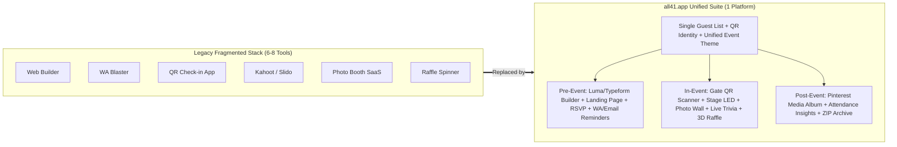

## 1.2 Core Platform Pillars
1. **One Platform, One Theme, Zero Friction:** An organizer chooses a theme once (Corporate or Wedding). Every surface—the public RSVP landing page, digital QR pass, email templates, mobile guest portal, live photo wall, trivia game arena, and ballroom stage LED display—inherits that exact aesthetic automatically.
2. **Luma Visual Simplicity + Typeform Conversational UX:** Creating an event takes under 60 seconds. Guests RSVP through a smooth, one-question-at-a-time Typeform-style flow on `<clientname>.all41.app`. All advanced modules (Games, Raffles, Photo Wall, Broadcasts, Stage LED) are configured post-creation inside the **10-Menu Event Command Suite**.
3. **Zero App Installation for Guests:** Guests never download a native iOS or Android app. Everything runs inside a high-performance, mobile-optimized Progressive Web App (PWA) at `<clientname>.all41.app` (or a custom Bring-Your-Own-Domain like `wedding.ariadaniel.com`), including direct WebRTC camera capture, client-side WebP compression, real-time quiz buzzers, and digital angpao QRIS.
4. **Check-in Gated Day-Of Interactivity (Single Source of Truth):** Participation in live venue features (Photo Wall uploads, Live Trivia Blitz, and Door Prize Raffles) is strictly bound to the guest's unique QR token in the Guest List and requires **verified on-site check-in** (`is_checked_in = true`). This guarantees zero spam from uninvited outsiders and 100% fair, auditable door prize draws where every winner is physically inside the ballroom.
5. **7-Module System-Locked Ballroom Stage LED:** The venue's main LED screen (`/events/[slug]/stage`) is governed by a strict 7-module master controller (`Welcome`, `Photo Wall`, `Quiz`, `Raffle`, `Rundown`, `Menu`, `Sponsors`) so the ballroom display always looks television-grade and never breaks.

> [!NOTE]
> **Development Priority Rule:** All engineering and design efforts are focused **100% on the core platform features and user experience first**. Commercial layers (Pricing tiers, EO/WO Partner Commissions, and Payment Gateway Integrations) are intentionally deferred to the final phase of rollout.

## 1.3 Target Market & User Personas

| Segment | Primary Use Cases | Core Pain Points Solved | Key all41.app Modules |
| :--- | :--- | :--- | :--- |
| **Corporate (HR, Marketing, Comms)** | Annual gatherings, APAC summits, product launches, townhalls, award galas | Disjointed tools, low audience engagement, manual attendance tracking, slow check-in lines | Corporate Keynote Landing Schema, Sub-second QR Gate Scanner, Kahoot-style Trivia Blitz, 3D Audited Raffle, 7-Module Stage LED |
| **Event Organizers (EO Agencies)** | Managing multiple parallel corporate & brand activation events per month | SaaS subscription fatigue, repetitive setup per client, lack of white-label domains, unrewarded referrals | Typeform-style 60s Event Studio, Multi-event Workspace, White-Label BYOD (`+Rp 250k`), 10–18% Partner Cashback Ledger |
| **Wedding Organizers (WO) & Couples** | 5-star hotel ballroom receptions, glasshouse destination weddings, private galas | Messy WhatsApp RSVPs, expensive physical photo booths, chaotic table seating, awkward cash angpao handling | Luxury Wedding Themes, Couple Love Story & Banquet Menu Schema, Digital Angpao (QRIS/Bank), Fonnte WA Blast, Pinterest Photo Wall |

### Geographic Focus
- **Beachhead Market:** Indonesia (Jakarta, Bali, Surabaya, Bandung, Medan).
- **Regional Expansion (SEA):** Singapore, Malaysia, Thailand, Philippines, Vietnam (powered by Xendit multi-currency conversion from IDR base pricing).
- **Product Language:** English default UI across all surfaces, engineered with an i18n-ready architecture for seamless localization (`id`, `ms`, `th`, `vi`, `fil`).

---
---

# [PAGE 02] END-TO-END EVENT LIFECYCLE (`HOW IT WORKS`)

**all41.app** orchestrates an event across three distinct chronological phases: **Phase 1: Pre-Event**, **Phase 2: In-Event (Day-Of Execution)**, and **Phase 3: Post-Event**.

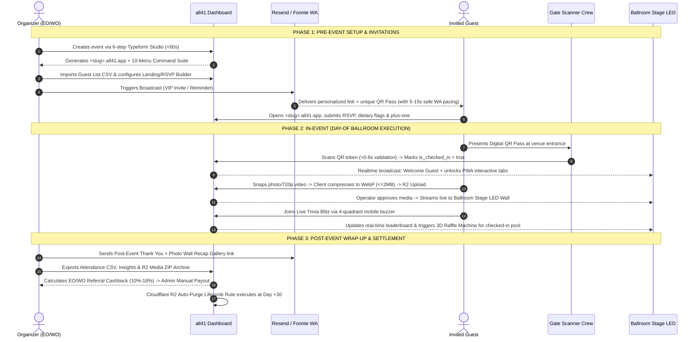

## 2.1 Phase 1: Pre-Event (Setup, Branding, RSVP & Broadcast)
1. **Typeform-Style Event Creation:** The organizer answers 6 rapid steps (Archetype: Corporate vs. Wedding, Event Title & Subdomain, Start/End Schedule, Venue Location, Theme Preset, and Target Capacity).
2. **Landing Page & Invitation Form Customization:** Inside the `Overview` menu, the organizer customizes hero posters, countdown timers, dress code swatches, keynote speakers (Corporate) or love story & digital angpao (Wedding), and custom RSVP questionnaire fields.
3. **Guest Roster & Table Allocation:** Organizers import attendees via CSV/Excel or add them manually in the `Guests` menu, assigning categories (`VVIP Speaker`, `VIP Delegate`, `Bridal Family`) and table numbers (`Diamond 01`, `Emerald 08`). Every guest receives a cryptographically unique `qr_code_token`.
4. **Multi-Channel Broadcast & Embeds:** Using the `Broadcast` menu, the organizer dispatches personalized invitations, RSVP confirmations, and 24-hour reminders via **Email (Resend)** or **WhatsApp (Fonnte BYON)** with template variables (`{{name}}`, `{{table}}`, `{{qr}}`). Organizers can also embed RSVP buttons or full iframes onto external websites.
5. **Inbound Registration Moderation:** Public RSVPs land in the `Registrations` queue where organizers can approve or decline requests with one click, automatically issuing QR passes upon approval.

## 2.2 Phase 2: In-Event (Gate Check-in, Stage LED & Live Engagement)
1. **Smart Gate QR Check-in:** Entrance crew open `/dashboard/events/[id]/checkin` on tablets or smartphones. Scanning a guest's QR pass validates their token in `<0.6s`, prevents duplicate entries, displays their VIP tier and table assignment, and flips `is_checked_in = true`.
2. **Unlocking Guest PWA Capabilities:** Once checked in, the guest's mobile portal (`<slug>.all41.app`) unlocks active participation in the **Photo Wall**, **Live Trivia Blitz**, and **Door Prize Raffle**.
3. **Pinterest Masonry Photo & Video Wall:** Guests snap photos or short 720p videos directly from their mobile browser. Images are compressed client-side into **WebP (≤2MB)** and videos capped at **≤20MB (720p)** before uploading to Cloudflare R2. Organizers can toggle **Captions Mode ON/OFF** (up to 300 characters). Guests can download media or share directly to Instagram/TikTok/WhatsApp.
4. **7-Module Ballroom Stage LED Display:** The venue's main LED screen runs `/events/[slug]/stage`, cycling through or locking onto 7 official system modules: `Welcome`, `Photo Wall`, `Quiz`, `Raffle`, `Rundown`, `Menu`, and `Sponsors`, complete with a live announcement ticker and QR overlay.
5. **Live Trivia Blitz & 3D Raffle Machine:** The MC and Operator trigger live Kahoot-style 4-quadrant quizzes (`/events/[slug]/games`) where guests use their phones as buzzers (`/events/[slug]/play`), followed by the 3D Door Prize Raffle (`/events/[slug]/raffle` featuring Slot Machine, Spinning Wheel, or Arcade Claw) drawing exclusively from checked-in guests.

## 2.3 Phase 3: Post-Event (Recap, Analytics, Rebate & 30-Day Lifecycle)
1. **Thank-You Broadcast & Album Sharing:** Organizers send a thank-you campaign linking guests to the post-event Pinterest photo gallery.
2. **Insights & Telemetry:** Organizers review check-in velocity curves, peak arrival times, total media uploads, and quiz participation rates in the `Insights` menu.
3. **30-Day Storage Retention & Export:** All Cloudflare R2 media assets remain live for **30 days post-event**. Organizers receive automated reminders to download/export the full high-resolution ZIP archive before the R2 lifecycle rule permanently purges media at Day +30.
4. **EO/WO Cashback Settlement:** Once an event transitions to `completed` and payment is settled, the system computes the agency referrer's cashback (`10%`, `12%`, `15%`, or `18%` based on final guest count ≥100) and credits their partner ledger for manual admin payout (minimum withdrawal `Rp 100.000`).

---
---

# [PAGE 03] MULTI-SURFACE ECOSYSTEM (`THE 6 CORE APPLICATION LAYERS`)

The **all41.app** monorepo powers **6 distinct user-facing surfaces** from a single Next.js 16 App Router codebase. Each surface is tailored to a specific device viewport, lighting environment, and operational role.

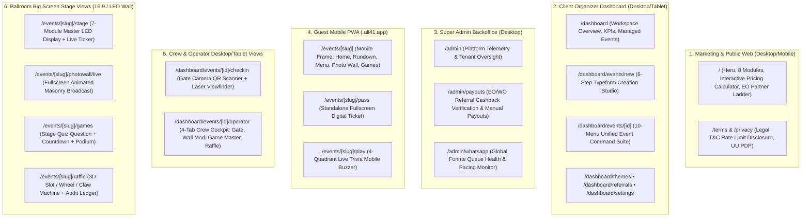

## 3.1 Surface-by-Surface Specification Matrix

| # | Surface Name | Target Users | Primary Device / Aspect Ratio | Key Route Paths | Design & UX Priorities |
| :--- | :--- | :--- | :--- | :--- | :--- |
| **1** | **Web (Home + Landing)** | Prospective clients, EOs, WOs, corporate buyers | Responsive Desktop & Mobile | `/`, `/terms`, `/privacy` | High-converting luxury dark aesthetic, interactive IDR pricing & extra-guest calculator, transparent EO cashback ladder |
| **2** | **Dashboard (Client)** | Event Organizers, Wedding Planners, Corporate HR | Desktop & Laptop (`1280px+` optimal, tablet-ready) | `/dashboard`, `/dashboard/events/new`, `/dashboard/events/[id]` | 6-step Typeform creation studio, 10-menu Event Command Center, instant state-driven tab switching, 1-click LIVE launchers |
| **3** | **Backend (Admin)** | all41.app Internal Super Admins & Finance Crew | Desktop (`1440px+`) | `/admin`, `/admin/payouts`, `/admin/whatsapp` | Manual EO/WO cashback verification & payout approval (`≥Rp 100k`), Fonnte rate-limit queue health, tenant capacity enforcement |
| **4** | **Front End (Guest PWA)** | Event Attendees, VIP Delegates, Wedding Guests | Mobile Smartphone (`375px–420px` portrait PWA) | `/events/[slug]`, `/events/[slug]/pass`, `/events/[slug]/play` | Zero app install, `.ticket-cutout` QR pass, bottom-sheet drawers, WebRTC camera viewfinder, dual Corporate/Wedding landing schema |
| **5** | **Front End (Operator & Gate)** | On-site AV Crew, MC, Moderation Staff, Gate Ushers | Desktop Control Laptop & Gate iPads/Phones | `/dashboard/events/[id]/operator`, `/dashboard/events/[id]/checkin` | High-contrast dark cockpit for dim control booths, gold bracket laser QR viewfinder, sub-second moderation & game state triggers |
| **6** | **Front End (Big Screen View)** | Ballroom Audience (100 to 2,500+ attendees) | 16:9 / Ultra-Wide LED Videotron & Projectors (`1080p`/`4K`) | `/events/[slug]/stage`, `/events/[slug]/photowall/live`, `/events/[slug]/games`, `/events/[slug]/raffle` | Giant `Outfit` display typography readable from 50 meters away, smooth 60fps animations, persistent QR subdomain overlay, live ticker |

---
---

# [PAGE 04] MASTER BRAND DESIGN SYSTEM & UI KIT (`STRICT TOKENS`)

> [!IMPORTANT]
> **100% Brand System Enforcement:** Every component in **all41.app** must strictly adhere to the Master Brand Design System (`media_1792567327203_13d9d26e.html`). Generic Tailwind blues (`bg-blue-600`, `bg-slate-900`, `#0f1320`) or unapproved gold shades (`#dfb76c`) are strictly forbidden in platform UI.

## 4.1 Official Color Palette Tokens (`src/app/globals.css`)

| Token Name | Tailwind Utility Class | Exact Hex | RGB / Alpha | Semantic Usage Across Platform |
| :--- | :--- | :--- | :--- | :--- |
| **Deep Black** | `bg-premium-black` / `text-premium-black` | `#09090B` | `rgb(9, 9, 11)` | Root page background canvas, table headers, deep contrast cutouts |
| **Charcoal Dark** | `bg-premium-charcoal` | `#18181B` | `rgb(24, 24, 27)` | Primary cards, modal containers, bento boxes, sidebar context cards |
| **Surface Dark** | `bg-premium-surfaceDark` | `#121214` | `rgb(18, 18, 20)` | Form inputs, nested inner cards, secondary button backgrounds, code blocks |
| **Border Dark** | `border-premium-borderDark` | `#27272A` | `rgb(39, 39, 42)` | Default 1px structural borders on cards, inputs, tables, and dividers |
| **Signature Gold** | `bg-premium-gold` / `text-premium-gold` / `border-premium-gold` | `#C5A059` | `rgb(197, 160, 89)` | Primary CTA buttons, active tab pills, circular `41` brand mark, VIP badges |
| **Gold Hover** | `hover:bg-premium-goldHover` | `#B38E46` | `rgb(179, 142, 70)` | Hover state for primary gold buttons and interactive accents |
| **Gold Dim** | `bg-premium-goldDim` | `rgba(197, 160, 89, 0.15)` | `15% Gold` | Subtle badge fills, icon containers, active card glows |
| **Neon Cyan** | `bg-premium-neon` / `text-premium-neon` | `#00F0FF` | `rgb(0, 240, 255)` | Live subdomain links, interactive game buzzers, camera shutter CTAs |
| **Neon Hover** | `hover:bg-premium-neonHover` | `#00C2CC` | `rgb(0, 194, 204)` | Hover state for neon cyan interactive buttons |
| **Neon Dim** | `bg-premium-neonDim` | `rgba(0, 240, 255, 0.12)` | `12% Cyan` | Tech badges, live sync indicators, secondary highlight pills |
| **Danger / Rose** | `bg-premium-danger` / `text-premium-danger` | `#FF3366` | `rgb(255, 51, 102)` | Risk disclosures, wedding heart accents, error states, live recording dots |
| **Success / Mint** | `bg-premium-success` / `text-premium-success` | `#00E676` | `rgb(0, 230, 118)` | Gate Active pulse dots, Checked-in verified badges, WhatsApp connected status |

## 4.2 Typography System (`next/font/google`)
Configured in [`src/app/layout.tsx`](file:///Users/drew83/Projects/all41/src/app/layout.tsx) and [`src/app/globals.css`](file:///Users/drew83/Projects/all41/src/app/globals.css):
1. **Display & Headings (`Outfit` — `.font-display`):**
   - Weights loaded: `400`, `500`, `600`, `700`, `800`.
   - Enforced tracking: `letter-spacing: -0.02em`.
   - Usage: Hero headlines, card titles, metric counters, modal headers, and the circular `41` badge.
2. **Body & UI Controls (`Manrope` — `.font-sans`):**
   - Weights loaded: `300`, `400`, `500`, `600`, `700`.
   - Usage: Paragraph copy, form labels, table cells, descriptions, and navigation items.
3. **Monospace Telemetry (`font-mono`):**
   - Usage: Subdomain URLs (`techunite.all41.app`), QR tokens (`QR-ALL41-BUDI-9812`), timestamps, and capacity counters.

## 4.3 Signature Brand Mark & Custom CSS Utilities

### The Official Circular Gold `41` Badge
Every navbar, sidebar, and guest PWA header renders the signature circular badge:
```tsx
<div className="w-10 h-10 bg-premium-gold rounded-full flex items-center justify-center text-premium-black font-display font-bold text-xl shadow-gold scale-on-click">
  41
</div>
```

### Master CSS Utility Classes (`src/app/globals.css`)
- **`.glass-panel`**: `background: rgba(24, 24, 27, 0.75); backdrop-filter: blur(20px); border: 1px solid rgba(255, 255, 255, 0.08);` — Used for floating bottom navigation docks and translucent headers.
- **`.ticket-cutout`**: Uses `radial-gradient` masks on left and right edges to create authentic physical VIP pass notches on digital QR tickets.
- **`.scale-on-click`**: `transition: transform 0.15s cubic-bezier(0.4, 0, 0.2, 1); active: scale(0.97);` — Mandatory tactile feedback on all buttons, cards, and interactive pills.
- **`.shadow-gold`**: `0 10px 30px -5px rgba(197, 160, 89, 0.25)` — Signature warm gold elevation glow.
- **`.shadow-neon` / `.glow-neon`**: `0 10px 30px -5px rgba(0, 240, 255, 0.25)` — High-tech cyan glow for games and camera triggers.
- **`.animate-scan-line`**: Smooth vertical 2.2s infinite laser sweep (`@keyframes scanLine`) inside the QR Gate Scanner viewfinder bracket.
- **Border Radii Standard:** Major cards and bento containers use `rounded-[2rem]` or `rounded-[2.5rem]`; buttons and inputs use `rounded-xl` or `rounded-2xl`.

---
---

# [PAGE 05] DUAL THEME ENGINE ARCHITECTURE (`CORPORATE VS. WEDDING`)

## 5.1 Architectural Rationale
Corporate summits and luxury weddings have fundamentally different emotional tones, information hierarchies, and guest workflows. Therefore, **all41.app** partitions its theme engine ([`src/lib/theme/defaultThemes.ts`](file:///Users/drew83/Projects/all41/src/lib/theme/defaultThemes.ts)) into two strongly-typed archetypes (`ThemeCategory = 'corporate' | 'wedding'`), each governed by a dedicated `LandingSchemaConfig`.

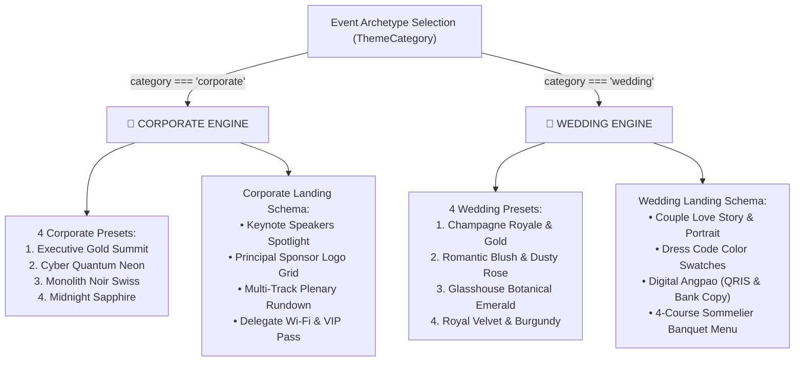

## 5.2 Complete Theme Preset Matrix (`src/lib/theme/defaultThemes.ts`)

| Preset ID | Display Name | Category | Primary | Secondary | Accent | Background | Font Family | Accent Badge |
| :--- | :--- | :--- | :--- | :--- | :--- | :--- | :--- | :--- |
| `corporate_executive_gold` | **Executive Gold Summit** | `corporate` | `#C5A059` | `#27272A` | `#00F0FF` | `#09090B` | `Outfit` | `APAC Executive Summit` |
| `corporate_cyber_quantum` | **Cyber Quantum Neon** | `corporate` | `#00F0FF` | `#18181B` | `#FF3366` | `#09090B` | `Outfit` | `Tech Keynote & Arena` |
| `corporate_monolith_noir` | **Monolith Noir Swiss** | `corporate` | `#E4E4E7` | `#27272A` | `#C5A059` | `#09090B` | `Manrope` | `Global Enterprise Forum` |
| `corporate_midnight_sapphire` | **Midnight Sapphire** | `corporate` | `#3B82F6` | `#1E293B` | `#10B981` | `#0B1120` | `Outfit` | `Cross-Border Fintech Rail` |
| `wedding_champagne_gold` | **Champagne Royale & Gold** | `wedding` | `#C5A059` | `#2D261E` | `#E5D3B3` | `#0E0C0A` | `Playfair Display` | `The Wedding Celebration` |
| `wedding_romantic_rose` | **Romantic Blush & Rose** | `wedding` | `#F43F5E` | `#2A161C` | `#C5A059` | `#0E0A0C` | `Cinzel` | `A Sacred Union of Hearts` |
| `wedding_glasshouse_emerald` | **Glasshouse Emerald** | `wedding` | `#10B981` | `#14251E` | `#C5A059` | `#0A100D` | `Playfair Display` | `Glasshouse Pavilion Nuptials` |
| `wedding_royal_velvet_maroon` | **Royal Velvet & Burgundy** | `wedding` | `#BE123C` | `#2B1218` | `#C5A059` | `#0E0608` | `Cinzel` | `Imperial Royal Gala` |

## 5.3 Dynamic Schema Adaptation on the Guest Portal
When a guest visits `/events/[slug]`, the portal inspects `event.event_type` and `event.theme_config.landingSchema`:
- **When `corporate` (`layoutType: 'corporate_keynote'`):**
  - Renders **Summit Parameters** & dedicated conference Wi-Fi credentials (`ALL41_GUEST`).
  - Displays the **Keynote Speakers Spotlight** card with speaker headshots, titles, and company affiliations.
  - Displays the **Principal Summit Partners** sponsor bar.
  - Formats the RSVP questionnaire for `Company / Organization` and `Job Role`.
- **When `wedding` (`layoutType: 'wedding_romance'`):**
  - Renders **Our Love Story** card with couple photography, romantic quote, and ceremony venue details.
  - Renders the **Wedding Dress Code Guide** with interactive visual color swatch chips (`#E5D3B3` Champagne, `#F43F5E` Dusty Rose, `#8A9A86` Sage Green, `#18181B` Black Tie).
  - Renders the **Digital Angpao / Cashless Gift Registry** card & modal featuring an official **QRIS barcode** and one-click copyable bank transfer details (e.g., BCA `8831 0928 41`) with celebratory confetti upon confirmation.

---
---

# [PAGE 06] FRICTIONLESS ONBOARDING (`LUMA + TYPEFORM EVENT BUILDER`)

## 6.1 Architectural Philosophy: Combining Luma's Visual Simplicity with Typeform's Guided Flow
Traditional enterprise event tools fail because they force organizers through a 40-field spreadsheet form before the event even exists. Conversely, consumer tools like Luma feel effortless because you see your cover poster, theme aesthetic, schedule timeline, and approval options right in front of you—while Typeform feels effortless because you focus on one clear decision at a time with keyboard shortcuts (`[1]`, `[2]`, `Enter ↵`).

**all41.app** combines the best of **both paradigms** inside [`src/app/dashboard/events/new/page.tsx`](file:///Users/drew83/Projects/all41/src/app/dashboard/events/new/page.tsx) and the post-creation studio:
1. **Zero Bloat During Creation:** Package billing, extra-guest blocks, Trivia questions, Raffle prizes, Photo Wall moderation rules, and Stage LED playlists are **never** asked during event creation. They live inside the **10-Menu Event Command Suite** after the event is created.
2. **Typeform-Style Conversational Studio + Luma Visual Split Canvas:**
   - Organizers can step through the **6-Step Typeform Studio** (`<60 seconds` with keyboard shortcuts `[1]`, `[2]`, `Enter ↵`, `↑/↓` and top gold progress bar) OR toggle directly into the **Luma-Style Split Canvas View**.
   - In the **Luma-Style Canvas**, the **Left Column** displays the interactive 1:1 / 4:5 **Event Cover Poster** (with 1-click upload/preset swap) and the **Theme Switcher Pill** (which opens the bottom floating theme dock filtered by `Corporate` vs `Wedding` with Colour, Style, Font, and Display selectors).
   - The **Right Column** provides inline, zero-border editable inputs for **Event Name**, a connected **Start → End Timeline Widget** with automatic `GMT+07:00 Jakarta` timezone badge, **Venue Location / Maps Pin**, **Event Description**, and the compact **Event Options Card** (`Require RSVP Approval` toggle + `Target Capacity` inline editor + `Create Event` primary gold button).

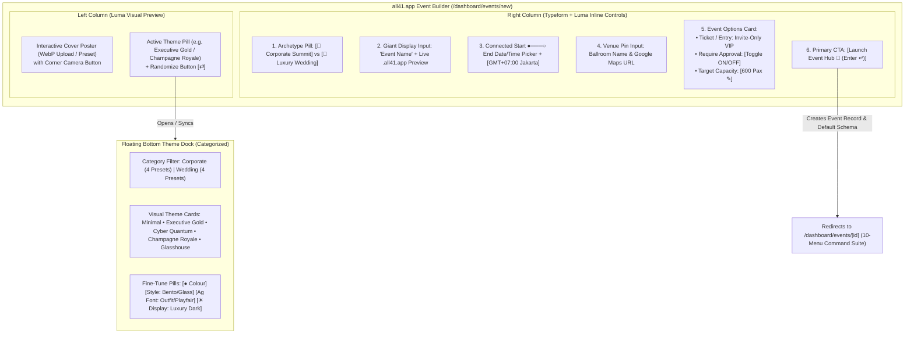

## 6.2 Step-by-Step Mechanics of the 6-Step Typeform Creation Studio
- **Top Gold Progress Bar:** Fixed `h-1.5` bar across the top viewport edge fills smoothly from `16.6%` (Step 1) to `100%` (Step 6) in `bg-gradient-to-r from-premium-gold to-premium-goldHover shadow-gold`.
- **Step 01 → Event Archetype (`Corporate` vs `Wedding`):**
  - Two large interactive bento cards with keyboard triggers (`Press [1]` for Corporate, `Press [2]` for Wedding).
  - Selecting an archetype immediately switches the active `LandingSchemaConfig` (`corporate_keynote` vs `wedding_romance`), swaps the default cover poster, and filters the theme catalog so wedding couples never see tech conference themes and corporate teams never see floral wedding themes.
- **Step 02 → Event Name & Live Subdomain Generator:**
  - Unbordered bottom-underlined `Outfit` display input (`text-4xl`).
  - As the organizer types `"TechUnite APAC Summit 2026"`, a real-time slugifier strips special characters and renders the live subdomain pill: `https://techunite-apac-summit-2026.all41.app` (editable if they want a shorter slug like `techunite.all41.app`).
- **Step 03 → Connected Start & End Schedule (`Luma Timeline Style`):**
  - Renders a connected vertical dotted timeline (`● Start` → `○ End`) with native date and 24-hour time pickers alongside a dedicated timezone card (`🌐 GMT+07:00 Jakarta / WIB`).
- **Step 04 → Venue & Ballroom Location:**
  - Captures both the display venue title (e.g., *The Grand Ballroom, Fairmont Jakarta*) and the exact street address or Google Maps link so the Guest PWA and Email Invitations can render 1-click navigation buttons (`Open in Google Maps / Waze`).
- **Step 05 → Categorized Theme Preset Selection:**
  - Calls `getThemesByCategory(eventType)` to present the 4 curated themes for that archetype, showing live color swatches (`primaryColor`, `accentColor`, `backgroundColor`), typography pairing (`Outfit`, `Manrope`, `Playfair Display`, or `Cinzel`), and layout schema preview.
- **Step 06 → Capacity, Approval Option & Instant Launch:**
  - Summarizes the entire event configuration in a gold-bordered executive card, lets the organizer set `Target Capacity (Pax)` and toggle `Require RSVP Approval`, and launches directly into `/dashboard/events/[id]?created=true`.

---
---

# [PAGE 07] THE 10-MENU EVENT COMMAND SUITE (`NAVIGATION & STATE ARCHITECTURE`)

Once an event is created via the Luma/Typeform Studio, the organizer enters [`/dashboard/events/[id]`](file:///Users/drew83/Projects/all41/src/app/dashboard/events/%5Bid%5D/page.tsx). Both the left context-aware [`Sidebar.tsx`](file:///Users/drew83/Projects/all41/src/components/dashboard/Sidebar.tsx) and the horizontal top tab bar expose **10 dedicated operational menus** powered by instant local React state (`handleTabChange`) synchronized with URL query parameters (`?tab=...`).

## 7.1 The 10-Menu Structural Matrix

| Menu # | Menu Name (`tabId`) | Sub-Tabs / Sections | Core Operational Responsibility |
| :--- | :--- | :--- | :--- |
| **01** | **`Overview`** (`overview`) | `Event Information` • `Landing Page Builder` • `Invitation Form Builder` | Edit core metadata, configure the public/guest landing blocks, and customize the Typeform RSVP questionnaire. |
| **02** | **`Guests`** (`guests`) | Confirmed Roster Table • VIP Tier Filter • CSV Import/Export | Manage the official Guest List, table/seat numbers (`Diamond 01`), unique `qr_code_token`, and live check-in status. |
| **03** | **`Registrations`** (`registrations`) | Pending Approval Queue • Approved • Declined | Review inbound public RSVP submissions and click **`Approve & Issue Pass`** to generate QR tokens and send passes. |
| **04** | **`Broadcast`** (`broadcast`) | Campaign Dispatcher (`Email` / `WA`) • Website Embeds (`Button` / `Iframe`) | Design & dispatch Invitations, Confirmations, 24h Reminders, and Thank-You blasts, or copy HTML embed snippets. |
| **05** | **`Games`** (`games`) | Question Bank Editor • Timer & Points Setup • Arena Launcher | Build multiple-choice rounds (`A/B/C/D`) for the Kahoot-style Live Trivia Blitz (`/events/[slug]/games`). |
| **06** | **`Door Prize`** (`raffle`) | 3D Visualizer Selector (`Slot` / `Wheel` / `Claw`) • Prize Catalog | Configure Grand Prizes and launch the 3D Door Prize Raffle Machine (`/events/[slug]/raffle`) for checked-in guests. |
| **07** | **`Photos`** (`photos`) | Captions Toggle (`ON ≤300c` / `OFF`) • Pinterest Masonry Moderation Grid | Moderate guest WebP photos and 720p videos, download media, and broadcast approved items to the Stage Wall. |
| **08** | **`Insights`** (`insights`) | Turnout Telemetry • Arrival Velocity • Media & Game KPIs | Monitor real-time check-in curves, average QR scan latency (`0.6s`), media uploads, and trivia participation. |
| **09** | **`LIVE`** (`live`) | 7-Card Active URL Launchers Command Grid | One-click launchers (`window.open(url, '_blank')`) for Guest PWA, Stage LED, Photo Wall, Raffle, Games, Gate Scanner & Operator Desk. |
| **10** | **`Setting`** (`setting`) | Subdomain & BYOD • Fonnte WA Token • Stage LED 7-Module Editor • Legal | Configure `<slug>.all41.app` / custom CNAME, link Fonnte WhatsApp, customize the 7 Stage LED modules, and edit T&C/Privacy. |

## 7.2 Context-Aware Sidebar & Zero-Lag Tab State Synchronization
In Next.js 16 App Router, relying solely on `router.push(?tab=...)` can introduce routing transitions. To make switching between the 10 menus feel instantaneous (`0ms` latency):
1. [`src/app/dashboard/events/[id]/page.tsx`](file:///Users/drew83/Projects/all41/src/app/dashboard/events/%5Bid%5D/page.tsx) maintains a local `const [activeTab, setActiveTab] = useState<EventTab>(...)` state that updates immediately on click (`handleTabChange`), while updating the URL query parameter (`router.push(..., { scroll: false })`) in parallel so browser refreshes and sidebar clicks stay 100% synchronized.
2. [`src/components/dashboard/Sidebar.tsx`](file:///Users/drew83/Projects/all41/src/components/dashboard/Sidebar.tsx) detects whenever the pathname matches `/dashboard/events/[id]` (excluding `/new`), automatically switching from Workspace navigation to the **10 Event Command Suite menus** plus a bottom **Active Live Rails** quick-launch panel.

---
---

# [PAGE 08] DEEP DIVE: LANDING PAGE BUILDER ENGINE (`OVERVIEW → LANDING BUILDER`)

The **Landing Page Builder** controls what invited guests and public visitors see when they open `https://<clientname>.all41.app`. Instead of a fragile freeform drag-and-drop canvas that breaks on mobile screens, **all41.app** uses a **Schema-Driven Modular Block Builder** tailored to `corporate` vs `wedding`.

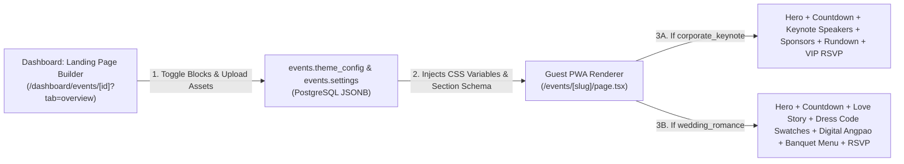

## 8.1 Complete TypeScript Schema for the Landing Page Builder
```typescript
export interface LandingPageBuilderConfig {
  archetype: 'corporate' | 'wedding';
  hero: {
    coverPosterWebpUrl: string;
    eyebrowBadgeText: string;       // e.g. "APAC EXECUTIVE SUMMIT" or "THE WEDDING CELEBRATION OF"
    headlineTitle: string;          // e.g. "TechUnite Summit 2026" or "Aria & Daniel"
    subheadlineText: string;
    showGoogleMapsButton: boolean;
  };
  countdown: {
    enabled: boolean;               // Toggles 4-cell DAYS : HRS : MINS : SECS counter
    liveBannerText: string;         // Shown when now >= start_date ("● EVENT IS LIVE NOW")
  };
  dressCode: {
    enabled: boolean;
    title: string;                  // e.g. "Black Tie & Batik" or "Champagne & Earth Tones"
    colorSwatches: Array<{ label: string; hex: string }>; // Up to 5 visual color chips
  };
  // Archetype Block A: Corporate Keynote Speakers OR Wedding Love Story
  speakersOrStory: {
    enabled: boolean;
    speakers?: Array<{ id: string; name: string; role: string; company: string; avatarUrl: string; topic: string }>;
    loveStory?: {
      brideName: string;
      brideParents: string;
      groomName: string;
      groomParents: string;
      romanticQuote: string;
      milestones: Array<{ year: string; title: string; description: string }>;
    };
  };
  // Archetype Block B: Corporate Sponsors OR Wedding Digital Angpao Registry
  sponsorsOrAngpao: {
    enabled: boolean;
    sponsors?: Array<{ id: string; name: string; tier: 'Title' | 'Platinum' | 'Gold'; logoUrl: string }>;
    digitalAngpao?: {
      qrisImageUrl: string;
      merchantName: string;
      bankAccounts: Array<{ bankName: string; accountNumber: string; accountHolder: string }>;
    };
  };
}
```

## 8.2 Block-by-Block Mechanics on the Guest Portal
1. **Block 1 — Hero Cover Poster & Visual Header:** Uploads a high-resolution cover image (auto-converted to `.webp` via Cloudflare R2) or selects from curated presets, rendering the eyebrow badge, `Outfit` / `Playfair` display headline, schedule pill, and 1-click Google Maps/Waze navigation button.
2. **Block 2 — Live Real-Time Countdown Clock:** Ticks down every second to `event.start_date` and automatically flips to a pulsing green `● EVENT IS LIVE NOW` badge when the event starts.
3. **Block 3 — Keynote Speakers Grid (Corporate) vs. Couple Love Story (Wedding):** Automatically adapts its UI card structure based on `event.event_type`.
4. **Block 4 — Dress Code & Attire Swatch Guide:** Renders interactive visual color circles (`#E5D3B3`, `#C5A059`, `#18181B`) so guests know the exact palette to wear.
5. **Block 5 — Tiered Sponsors (Corporate) vs. Digital Angpao Cashless Registry (Wedding):** In Wedding mode, guests can scan the couple's **QRIS Barcode** or tap **1-Click Copy Account Number** (`navigator.clipboard.writeText`) with a celebratory confetti burst.
6. **Block 6 — Interactive Rundown & 4-Course Banquet Menu:** Time-stamped agenda items (highlighting the `● Now Active` session) and culinary courses (`Appetizer`, `Main Course`, `Dessert`, `Beverages`) with dietary tags (`Halal`, `Vegan`, `Gluten-Free`).

---
---

# [PAGE 09] DEEP DIVE: DIGITAL INVITATION & TYPEFORM-STYLE RSVP FORM BUILDER

Located under `Overview → Invitation Form Builder`, this engine controls how guests confirm their attendance on `<clientname>.all41.app`.

## 9.1 Dual Entry Modes: Pre-Invited VIP Token vs. Public Registration
1. **Mode 1 — Personalized Token Link (`<slug>.all41.app?invite=QR-ALL41-TECH26-8F92A1C4-E7B9`):**
   - Sent via WhatsApp or Email to guests already imported into the `Guests` roster.
   - When the guest opens the link, the client resolves their token, greets them personally (*"Welcome back, Budi Santoso!"*), pre-fills their Name, WhatsApp, Email, and VIP Category, and steps them through confirming attendance, dietary preferences, and companion details.
2. **Mode 2 — Open / Public Registration (`<slug>.all41.app`):**
   - For public events or open RSVP links. Visitors complete the Typeform-style questionnaire and—when `Require Approval` is enabled—land in the **`Registrations` Approval Queue** (`rsvp_status = 'pending'`) until the organizer clicks **`Approve & Issue Pass`**.

## 9.2 Typeform-Style Conversational RSVP State Machine
When a guest taps **`RSVP / Confirm Attendance`** on `<slug>.all41.app`, a fullscreen **Typeform-Style Conversational Drawer** opens, presenting **one focused question per screen** with keyboard shortcuts (`[A]`, `[B]`, `Enter ↵`) and a top gold progress bar:

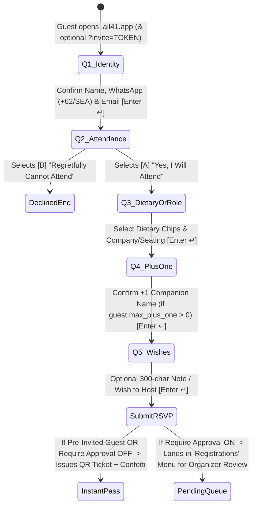

## 9.3 Configurable Question Schema (`InvitationFormSchema`)
```typescript
export interface InvitationFormField {
  id: string;
  type: 'text' | 'phone_wa' | 'email' | 'rsvp_choice' | 'dietary_chips' | 'plus_one' | 'select' | 'textarea';
  label: string;
  placeholder?: string;
  required: boolean;
  enabled: boolean;
  options?: string[];             // For 'select' or 'dietary_chips' (e.g. ['None', 'Vegetarian', 'Vegan', 'No Beef', 'Halal'])
  conditionalOn?: { fieldId: string; equalsValue: string | boolean };
}
```
- **Conditional Plus-One Logic:** If a guest is allocated `max_plus_one >= 1` in the Guest Roster and selects *"Yes, bringing +1 companion"*, the Typeform flow dynamically inserts Step `4B`: *"What is your companion's full name & dietary preference?"*
- **One-Click Organizer Moderation (`Registrations` Menu):** In `/dashboard/events/[id]?tab=registrations`, organizers see every pending registrant's answers (`Organization: Sequoia APAC • Dietary: Vegetarian • +1: Siti`). Clicking **`Approve & Issue Pass`** atomically moves them to the confirmed `Guests` roster, generates their HMAC `qr_code_token`, and triggers the `RSVP Confirmation & QR Pass` email/WhatsApp.

---
---

# [PAGE 10] DEEP DIVE: EMAIL BUILDER, AUTOMATED REMINDERS, `.ICS` & WEBSITE EMBEDS

Located in the **`Broadcast`** menu (`/dashboard/events/[id]?tab=broadcast`), this engine powers all pre-event invitations, H-1 reminders, instant QR pass deliveries, and external website embeds.

## 10.1 The 5 Lifecycle Campaign Triggers

| # | Campaign Trigger | Firing Mechanism | Target Segment | Key Dynamic Assets Embedded |
| :--- | :--- | :--- | :--- | :--- |
| **1** | **`VIP Invitation`** | Manual blast or scheduled date | `rsvp_status = 'pending'` | Hero Cover Banner, Event Details, Personalized `?invite=TOKEN` CTA Button |
| **2** | **`RSVP Confirmation & QR Pass`** | Auto-triggered on RSVP `attending` or Approval | `rsvp_status = 'attending'` | High-contrast **Inline QR Code PNG**, Table/Seat Number, VIP Badge, **`.ics` Calendar File** |
| **3** | **`H-1 / 24h Event Reminder`** | Auto-scheduled 24h before `start_date` (or manual) | Confirmed attendees (`attending`) | Countdown Banner, Dress Code Color Swatches, Google Maps Pin, Quick-Scan QR Pass |
| **4** | **`Gate Check-in Welcome`** | Auto-triggered on Gate QR Scan (`<1s` after scan) | Newly checked-in guest | *"Welcome {{name}}! Your Table is {{table}}. Tap here to open the Live Photo Wall & Trivia Buzzer."* |
| **5** | **`Post-Event Thank You & Album`** | Manual or scheduled 12h after `end_date` | Checked-in attendees (`is_checked_in = true`) | Host Thank-You Note + Direct Link to the Pinterest Masonry Photo & Video Recap Gallery |

## 10.2 Visual Luxury HTML Email Builder & Merge Tag Engine (`Resend`)
1. **Theme-Synced Dark & Gold HTML Template:**
   - Every email is compiled into a responsive, email-client-safe HTML table layout (`#09090B` outer canvas, `#18181B` card body, `#C5A059` gold accents) that renders identically in Apple Mail, Gmail, and Outlook.
   - **Important QR Contrast Rule:** Even though the email card is luxury dark, the embedded **QR Pass Box** inside the email is always rendered on a pure `#FFFFFF` white background pad with `#000000` QR modules (`240x240px`) so optical scanners can read the QR code directly off the email screen even in dark mode.
2. **Dynamic Merge Tags Interpolator:**
   - Supports `{{name}}`, `{{category}}`, `{{table}}`, `{{event_name}}`, `{{event_date}}`, `{{venue_name}}`, `{{dress_code}}`, `{{rsvp_url}}`, and `{{qr_pass_image}}`.
3. **RFC-5545 `.ics` Calendar Attachment Generator:**
   - Every confirmation and reminder email attaches a generated `event-invite.ics` file so the event automatically appears on the guest's iOS/Google Calendar with a 2-hour native alarm:
   ```typescript
   export function generateEventIcsFile(event: Event, guest: Guest): string {
     const formatIcsDate = (iso: string) => iso.replace(/[-:]/g, '').split('.')[0] + 'Z';
     return [
       'BEGIN:VCALENDAR',
       'VERSION:2.0',
       'PRODID:-//all41.app//Luxury Event Suite//EN',
       'METHOD:REQUEST',
       'BEGIN:VEVENT',
       `UID:${guest.qr_code_token}@all41.app`,
       `DTSTAMP:${formatIcsDate(new Date().toISOString())}`,
       `DTSTART:${formatIcsDate(event.start_date)}`,
       `DTEND:${formatIcsDate(event.end_date)}`,
       `SUMMARY:${event.name} (${guest.category} Pass)`,
       `LOCATION:${event.location_name} - ${event.location_address}`,
       `DESCRIPTION:VIP Pass for ${guest.name} | Table: ${guest.table_number ?? 'TBA'} | Token: ${guest.qr_code_token} | Portal: https://${event.slug}.all41.app`,
       'BEGIN:VALARM',
       'TRIGGER:-PT2H',
       'ACTION:DISPLAY',
       'DESCRIPTION:Event Reminder',
       'END:VALARM',
       'END:VEVENT',
       'END:VCALENDAR',
     ].join('\r\n');
   }
   ```

---
---

# [PAGE 11] ATTENDANCE SYSTEM PART 1: CRYPTOGRAPHIC QR GENERATOR & VIP PASS

The Attendance System is the single source of truth that connects pre-event invitations to in-event ballroom participation. Part 1 covers how **all41.app** generates tamper-proof QR codes and renders the digital VIP ticket pass.

## 11.1 Cryptographic HMAC-SHA256 QR Token Generator
Instead of sequential integers (`guest_1`, `guest_2`) or plain UUIDs that require a database roundtrip before knowing if a QR code even belongs to the event, **all41.app** generates structured, self-verifying tokens:
$$\texttt{QR-ALL41-}\underbrace{\texttt{TECH26}}_{\text{6-Char Event Prefix}}\texttt{-}\underbrace{\texttt{8F92A1C4}}_{\text{8-Char Guest Hex}}\texttt{-}\underbrace{\texttt{E7B9}}_{\text{4-Char HMAC-SHA256}}$$

```typescript
import crypto from 'crypto';

export function generateGuestQrToken(eventSlug: string, guestId: string, secretKey: string): string {
  const prefix = eventSlug.replace(/[^a-zA-Z0-9]/g, '').toUpperCase().slice(0, 6).padEnd(6, 'X');
  const guestHex = guestId.replace(/-/g, '').toUpperCase().slice(0, 8);
  const payload = `${prefix}:${guestHex}`;
  const hmac = crypto
    .createHmac('sha256', secretKey)
    .update(payload)
    .digest('hex')
    .toUpperCase()
    .slice(0, 4);

  return `QR-ALL41-${prefix}-${guestHex}-${hmac}`;
}
```
- **Why this structure is optimal:**
  1. **Human & Usher Readable:** If a camera is unavailable, an usher can type the 8-character `8F92A1C4` code or read the `TECH26` prefix at a glance.
  2. **Zero-Latency Forgery Rejection:** The Gate Scanner verifies the 4-character `HMAC` checksum locally in `<0.2ms`, immediately rejecting random or tampered QR codes.
  3. **Optimal QR Matrix Density:** At 27 alphanumeric characters, the QR code uses **QR Version 2 (25×25 modules)** with High Error Correction (`Level H — 30% damage recovery`). Because the squares are large and sparse, smartphone and iPad cameras lock onto the QR code from **up to 1.2 meters away in under 150 milliseconds**.

## 11.2 The `.ticket-cutout` Digital VIP Pass (`/events/[slug]` & `/events/[slug]/pass`)
On the Guest Mobile PWA, the guest's pass is styled using our custom `.ticket-cutout` CSS mask (`radial-gradient` notches on the left and right edges) and displays:
- **Header:** Event Logo, Circular `41` Gold Badge, and `VIP CATEGORY` pill (`VVIP Speaker`, `Bridal Family`).
- **Center QR Pad:** `240×240px` high-contrast QR matrix (`#000000` on `#FFFFFF`) with a subtle gold border.
- **Footer Allocation Grid:** Guest Full Name, **`TABLE DIAMOND 01`** callout, Plus-One count, live status pill (`✅ Checked-In` vs `Awaiting Gate Scan`), and **`Download Pass to Phone Gallery`** button.

---
---

# [PAGE 12] ATTENDANCE SYSTEM PART 2: GATE QR READER & `INDEXEDDB` OFFLINE SYNC

Crew members at the ballroom entrance operate [`/dashboard/events/[id]/checkin`](file:///Users/drew83/Projects/all41/src/app/dashboard/events/%5Bid%5D/checkin/page.tsx) on iPads/smartphones or via the Operator Desk (`/dashboard/events/[id]/operator`).

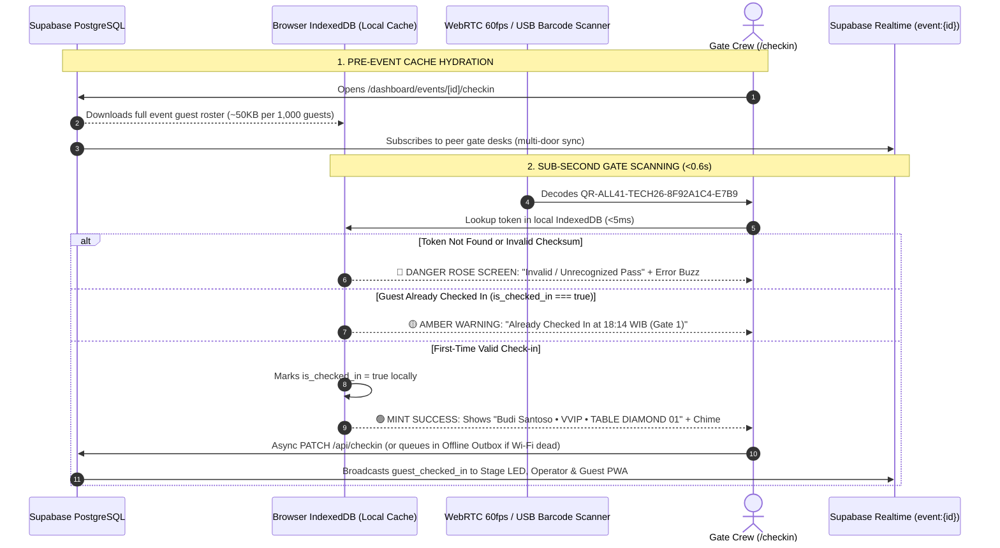

## 12.1 Dual Hardware Input Modes (Camera WebRTC + USB/Bluetooth 2D Scanner)
1. **Mode A — WebRTC Camera Viewfinder (`BarcodeDetector` + `jsQR`):**
   - Streams `facingMode: 'environment'` at `1280×720` inside the gold corner brackets with the `.animate-scan-line` laser sweep.
   - Applies a **2.5-second cooldown debounce per identical token** so holding a phone in front of the camera doesn't trigger a false duplicate warning 100ms after the first scan.
2. **Mode B — Hardware 2D Barcode Scanner (HID Keyboard Wedge Mode):**
   - For 1,500–2,500 pax corporate summits using handheld Zebra/Honeywell 2D scanners plugged into laptops, `/checkin` listens to rapid keystroke bursts ending in `Enter ↵` (`<30ms` per character) and validates the scanned token automatically without needing to click into an input box.

## 12.2 Offline-First Ballroom Dead-Zone Architecture (`IndexedDB` Outbox)
Hotel ballrooms located in basement levels often experience intermittent Wi-Fi drops when 1,000+ guests arrive simultaneously:
- The scanner stores the entire `guests` roster in `IndexedDB` store `all41_gate_roster_{eventId}` and keeps an `all41_checkin_outbox` queue.
- If `navigator.onLine === false` or a fetch times out (`>1500ms`), the gate usher experiences **zero interruption**—guests are still validated and shown their Table Number in `<10ms` from local cache, while the check-in timestamp is queued in `all41_checkin_outbox` and automatically synced to Supabase when Wi-Fi recovers.

---
---

# [PAGE 13] GUEST MOBILE PWA & PINTEREST MASONRY PHOTO/VIDEO WALL

Once inside the ballroom, guests interact with [`/events/[slug]`](file:///Users/drew83/Projects/all41/src/app/events/%5Bslug%5D/page.tsx) and the live [`PinterestMasonryPhotoWall.tsx`](file:///Users/drew83/Projects/all41/src/components/events/PinterestMasonryPhotoWall.tsx).

## 13.1 Client-Side WebP Compression (`≤2MB`) & 720p Video (`≤20MB`) Pipeline
To ensure fast uploads over crowded venue Wi-Fi and zero-lag rendering on the Ballroom Stage LED wall, all media is validated and optimized client-side before touching Cloudflare R2:

```typescript
export async function compressImageToWebP(file: File, maxDimension = 1920, quality = 0.82): Promise<Blob> {
  const bitmap = await createImageBitmap(file);
  const scale = Math.min(1, maxDimension / Math.max(bitmap.width, bitmap.height));
  const width = Math.round(bitmap.width * scale);
  const height = Math.round(bitmap.height * scale);

  const canvas = document.createElement('canvas');
  canvas.width = width;
  canvas.height = height;
  const ctx = canvas.getContext('2d')!;
  ctx.drawImage(bitmap, 0, 0, width, height);

  const blob = await new Promise<Blob | null>((resolve) => canvas.toBlob(resolve, 'image/webp', quality));
  if (!blob || blob.size > 2 * 1024 * 1024) {
    throw new Error('Compressed WebP image exceeds the 2MB maximum limit.');
  }
  return blob;
}
```
- **Media Upload Rules:**
  - **Images:** Automatically resized and encoded to `.webp` (`≤ 2MB`).
  - **Videos:** Up to **`20MB` (`720p` MP4/WebM)**.
  - **Per-Guest Quota:** Up to **10 media uploads per checked-in guest**.
  - **Admin Captions Toggle (`enablePhotoWallCaptions`):**
    - When toggled **ON** in the event's `Photos` or `Setting` menu, guests can type a short caption or blessing up to **300 characters** (`maxLength={300}`).
    - When toggled **OFF**, the caption text field is completely hidden on the guest uploader and captions are hidden on the grid—displaying pure photography and video only.

## 13.2 Pinterest Masonry Layout, Download & Social Share
- **Multi-Column Pinterest Grid:** [`PinterestMasonryPhotoWall.tsx`](file:///Users/drew83/Projects/all41/src/components/events/PinterestMasonryPhotoWall.tsx) uses `columns-2 sm:columns-3 lg:columns-4 gap-4 space-y-4` so portrait (`9:16` stories), square (`1:1`), and landscape (`16:9` group shots) tessellate naturally without cropping heads.
- **Lightbox Actions (Download + Share + Broadcast):**
  1. **Download Button:** Downloads the high-res `.webp` or `.mp4` directly to the guest's smartphone.
  2. **Share to Social Media Button:** Invokes the native mobile Web Share API (`navigator.share({ title, text, url })`) so guests can post directly to Instagram Stories, TikTok, or WhatsApp in 1 tap.
  3. **Broadcast to Stage Wall (Admin/Operator):** Pushes the selected photo/video directly to the Ballroom Stage LED screen.

---
---

# [PAGE 14] BALLROOM STAGE LED 7-MODULE MASTER DISPLAY (`/STAGE`)

To prevent broken layouts or accidental desktop browser clutter on multi-million-rupiah ballroom LED walls, **all41.app** provides a dedicated 16:9 / 4K broadcast display at [`/events/[slug]/stage`](file:///Users/drew83/Projects/all41/src/app/events/%5Bslug%5D/stage/page.tsx), configured exclusively through [`StageLedEditor.tsx`](file:///Users/drew83/Projects/all41/src/components/dashboard/StageLedEditor.tsx).

## 14.1 Strict System-Locked 7-Module Architecture
Organizers cannot inject arbitrary unstyled widgets onto the stage screen. They can only enable, reorder, set rotation durations, or manually lock onto the **7 official system modules**:

| Module # | Module Key | Stage Visual Layout (`1920×1080` / `3840×2160`) | Default Duration |
| :--- | :--- | :--- | :--- |
| **01** | `welcome` | **Welcome & Keynote Hero:** Giant `Outfit` display title, organization badge, live check-in counter (`418 / 650 Checked In`), and Venue Wi-Fi credentials. | `20s` |
| **02** | `photowall` | **Live Pinterest Masonry Photo Wall:** Auto-scrolling multi-column masonry feed of approved guest WebP photos and muted-autoplay 720p videos. | `30s` |
| **03** | `quiz` | **Live Trivia Blitz Arena:** Displays active question prompt, 15s countdown ring, 4 color-coded answer quadrants, and Top 5 Leaderboard. | `25s` |
| **04** | `raffle` | **3D Door Prize Raffle Showcase:** Displays the active Grand Prize (`MacBook Pro M4 Max`), eligible checked-in pool count, and verified winners. | `20s` |
| **05** | `rundown` | **Event Rundown & Agenda:** Highlights the `● NOW ACTIVE` session in gold alongside upcoming keynote or wedding milestones. | `20s` |
| **06** | `menu` | **Executive Banquet Menu:** Showcases the 4-course culinary menu (`Appetizer`, `Main Course`, `Dessert`, `Beverages`) with dietary badges. | `20s` |
| **07** | `sponsors` | **VIP Sponsors & Partners:** Displays tiered corporate sponsor logos or wedding couple thank-you credits. | `15s` |

## 14.2 Auto-Rotation Loop vs. Instant Operator Lock Override
- **Auto-Rotation Mode (`activeMode: 'auto_rotate'`):** During cocktail hour or banquet dining, the Stage LED cycles smoothly through all enabled modules (`enabled: true`) according to each module's configured `durationSeconds`.
- **Instant Operator Lock (`activeMode: 'quiz' | 'raffle' | 'photowall' ...`):** When the MC steps on stage for the Live Trivia Game or Door Prize Draw, the Operator clicks a single button in the Cockpit to lock the Stage LED onto `quiz` or `raffle` in `<100ms` via Supabase Realtime broadcast.
- **Persistent Overlays:** Includes a toggleable **Corner QR Join Card** (`<slug>.all41.app`) and a bottom **Live Broadcast Ticker Bar** (`tickerText`) for real-time announcements.

---
---

# [PAGE 15] GAMIFICATION PART 1: KAHOOT-STYLE LIVE TRIVIA BLITZ (`/GAMES` & `/PLAY`)

The Live Trivia Blitz turns every checked-in guest's smartphone into a real-time wireless game controller synchronized with the Ballroom Stage LED screen.

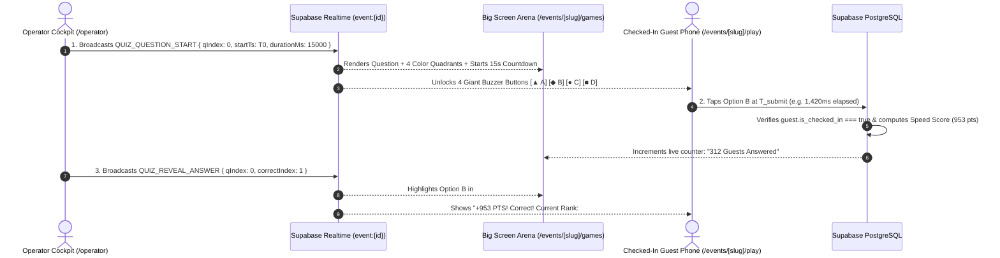

## 15.1 Big Screen Host View (`/events/[slug]/games`) vs. Mobile Buzzer (`/events/[slug]/play`)
1. **Big Screen Host View (`/events/[slug]/games`):**
   - Designed for 50-meter readability in a large ballroom.
   - Left 8 columns display the question badge (`Question 1 of 3 • 1000 PTS`), the question headline, the 15-second countdown timer, and the 4 answer quadrants (`A`, `B`, `C`, `D`).
   - Right 4 columns display the **Live Top Leaderboard**, showing each top player's Rank, Name, **Assigned Table Number** (`Table Diamond 01`), and cumulative score.
2. **Mobile Guest Buzzer (`/events/[slug]/play`):**
   - Verified checked-in guests see a distraction-free 2×2 grid of giant tactile buttons (`scale-on-click`) with geometric icons (`▲`, `◆`, `●`, `■`) so they don't even have to read small text on their phone—they look up at the big stage screen and tap the matching color/shape on their phone.

## 15.2 Millisecond Speed-Weighted Scoring Formula
To prevent 50 guests from tying for 1st place when they all answer all questions correctly, **all41.app** weights each correct answer by millisecond reaction speed:
$$\text{Points} = \text{round}\!\left(\text{BasePoints} \times \left(1 - \frac{\min(\Delta t, T_{\text{max}})}{2 \cdot T_{\text{max}}}\right)\right)$$
- Answering correctly at $\Delta t = 0\text{ms}$ yields $100\%$ of $\text{BasePoints}$ (`1,000 pts`).
- Answering at the very last millisecond ($\Delta t = T_{\text{max}}$) still yields $50\%$ of $\text{BasePoints}$ (`500 pts`).
- Answering incorrectly yields `0 pts`.

---
---

# [PAGE 16] GAMIFICATION PART 2: 3D DOOR PRIZE RAFFLE MACHINE (`/RAFFLE`)

The 3D Door Prize Raffle Machine ([`src/app/events/[slug]/raffle/page.tsx`](file:///Users/drew83/Projects/all41/src/app/events/%5Bslug%5D/raffle/page.tsx)) replaces cheap 2D web wheels with a theatrical, television-grade stage show featuring **three selectable visualizer modes** and a **cryptographically audited winner ledger**.

## 16.1 Three Selectable 3D Stage Visualizer Modes
Organizers or Operators can switch between 3 distinct draw machines at any time depending on the prize tier:
1. **`🎰 Slot Machine 777` (`style: 'slot'`):**
   - Renders a luxury gold-and-obsidian 3-reel casino machine on the stage LED screen.
   - When triggered, Reel 1 cycles rapidly through `QR Tokens`, Reel 2 cycles through `Table Numbers`, and Reel 3 cycles through `Guest Names`, locking sequentially (`Reel 1` at `1.8s` → `Reel 2` at `2.6s` → `Reel 3` at `3.4s`) for maximum audience suspense.
2. **`🎡 Wheel of Spin` (`style: 'wheel'`):**
   - Renders a high-contrast radial wheel with gold and charcoal segments and a top diamond pointer needle, decelerating smoothly over `3.4 seconds` (`cubic-bezier(0.15, 0.85, 0.25, 1)`).
3. **`🕹️ Arcade Claw Machine` (`style: 'claw'`):**
   - Renders an animated cyber-gold robotic gantry claw that traverses horizontally, drops into a pit of glowing neon/gold capsule orbs, grabs the winning guest's orb, and lifts it to center stage.

## 16.2 Cryptographic CSPRNG Selection & Anti-Repeat Rules
```typescript
export function selectCryptographicRaffleWinner(eligibleGuests: Guest[]): Guest {
  if (eligibleGuests.length === 0) {
    throw new Error('No eligible checked-in guests remaining in the draw pool.');
  }
  const randomBuffer = new Uint32Array(1);
  crypto.getRandomValues(randomBuffer);
  const winningIndex = randomBuffer[0] % eligibleGuests.length;
  return eligibleGuests[winningIndex];
}
```
- **Strict Eligibility Filter:**
  1. `guest.is_checked_in === true` (Must have scanned their QR pass at the venue gate).
  2. `guest.id NOT IN (claimedWinners)` (A guest who has already won a prize cannot win a second time).
- **Claimed vs. Absent Redraw Audit Trail:**
  - When a winner is drawn, the Stage LED displays their **Full Name**, **VIP Tier**, **Table Number (`TABLE DIAMOND 01`)**, and **QR Token**, while firing dual-side confetti cannons.
  - If the winner comes to the stage, the Operator clicks **`Confirm Claimed ✅`**.
  - If the winner has already left the venue, the Operator clicks **`Absent — Void & Redraw 🔄`**, which logs the absent draw in the **Audited Winners Ledger** (`is_claimed = false`) and immediately spins for a new present winner.

---
---

# [PAGE 17] DEEP REAL-TIME INTEGRATION (`ATTENDANCE ↔ GAMES ↔ RAFFLES ↔ STAGE`)

Pages 11 through 16 describe the individual modules; Page 17 illustrates how they interlock into a **single unified real-time state machine** so data flows seamlessly across the Gate Scanner, Guest Mobile PWA, Operator Cockpit, and Ballroom Stage LED.

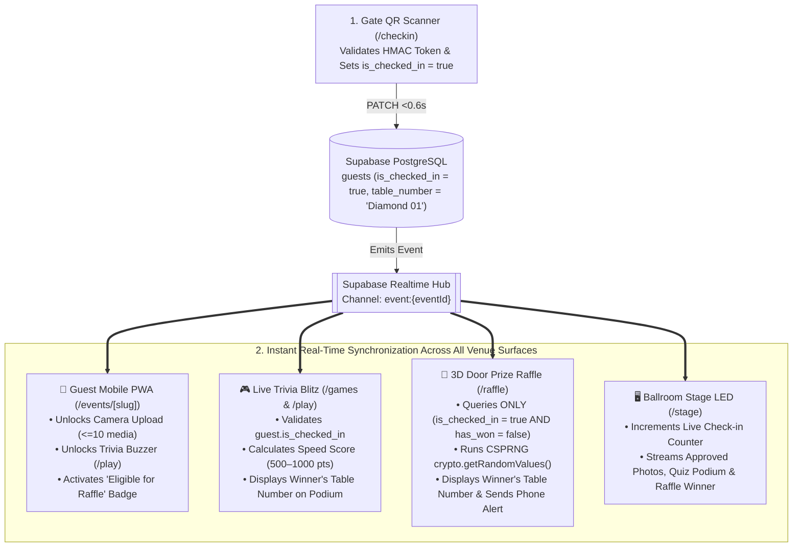

## 17.1 Why Unified Integration Beats Disconnected Tools
1. **Table Number Propagation Everywhere:** Because the guest's `table_number` (`Diamond 01`) lives on the same `guests` row as their `qr_code_token`:
   - When they upload a photo to the **Pinterest Photo Wall**, their card automatically displays `"Uploaded by Budi • Table Diamond 01"`.
   - When they reach the top of the **Live Trivia Blitz Leaderboard**, the stage podium announces `"1st Place: Budi Santoso — Table Diamond 01"` so the spotlight operator knows exactly which table to light up.
   - When they win the **3D Door Prize Raffle**, the slot machine reels lock onto `"TABLE DIAMOND 01"` before revealing `"BUDI SANTOSO"`.
2. **Zero Manual CSV Re-Exports During the Event:** The organizer never has to export checked-in guests from a gate app and import them into a raffle wheel app 5 minutes before the draw—the 3D Raffle pool updates dynamically with every single QR scan at the door.

---
---

# [PAGE 18] CREW OPERATOR BROADCAST SWITCHER, PREVIEW/LIVE MONITOR, QUEUES, LAUNCHERS & INSIGHTS

To ensure zero-mistake execution inside a live ballroom, **all41.app** equips the organizer and on-site AV technical director with a television-grade **Broadcast Switcher & Preview Verification Deck** inside the Crew Operator Cockpit ([`src/app/dashboard/events/[id]/operator/page.tsx`](file:///Users/drew83/Projects/all41/src/app/dashboard/events/%5Bid%5D/operator/page.tsx)), synchronized in real time with the **Ballroom Stage LED Big Screen** ([`src/app/events/[slug]/stage/page.tsx`](file:///Users/drew83/Projects/all41/src/app/events/%5Bslug%5D/stage/page.tsx)).

## 18.1 Frontend Operator ↔ Active Big Screen Broadcast Switcher (`/dashboard/events/[id]/operator`)
Before anything appears on the ballroom's 16:9 / 4K LED videotron, the operator must be able to **preview, verify, customize the timer or manual click trigger, and inspect all incoming queues**. Our Operator Cockpit implements a dual-monitor broadcast switcher architecture:

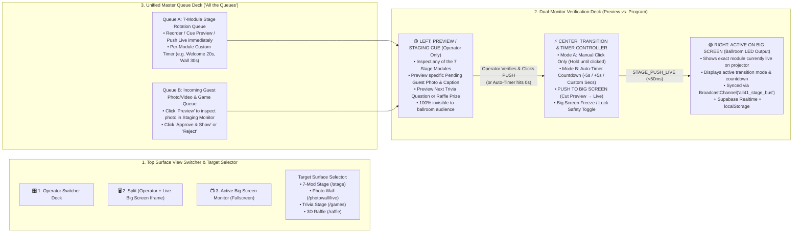

### Key Capabilities of the Operator ↔ Big Screen Switcher:
1. **3-Mode Surface View Switcher (Top Navigation Bar):**
   - **`1. Operator Switcher Deck`**: Full broadcast console with dual Preview/Live monitors, transition controls, master queues, and the 4 operational sub-tabs.
   - **`2. Split (Operator + Big Screen)`**: Side-by-side layout displaying the Operator Controls & Queue Deck on the left (`50%` width) and a live interactive `<iframe>` of the selected Active Big Screen (`/events/[slug]/stage`, `/photowall/live`, `/games`, or `/raffle`) on the right (`50%` width) so the operator sees pixel-for-pixel what the ballroom projector displays.
   - **`3. Active Big Screen Monitor`**: Fullscreen live monitor of the selected Big Screen surface inside the operator window, with a 1-click button to return to the Operator Deck or pop out a dedicated HDMI projector window.
2. **Dual Preview (Staging Cue) vs. Active (Program Live) Verification:**
   - **Left Monitor (`🟡 PREVIEW / STAGING MONITOR`):** The operator can click any stage module (`Welcome`, `Photo Wall`, `Live Trivia`, `3D Raffle`, `Rundown`, `VIP Menu`, `Sponsors`), or click **`Preview`** on any pending guest photo/caption or quiz question, to inspect how it looks *before* the audience sees it.
   - **Right Monitor (`🟢 ACTIVE ON BIG SCREEN`):** Shows what is currently live on the ballroom LED wall, along with a **`Big Screen LOCKED (Freeze On)`** safety button that freezes the ballroom screen while the operator prepares the next segment backstage.
3. **Customizable Transition Trigger (`👆 Manual Click Mode` vs. `⏱️ Auto Timer Mode`):**
   - **`Manual Click Mode`**: The ballroom big screen stays locked on the current module indefinitely until the operator explicitly clicks the gold **`PUSH TO BIG SCREEN`** button (or **`Skip to Next Module in Queue`**).
   - **`Auto Timer Mode`**: Runs a live countdown (`timerRemaining` in seconds) that automatically pushes the queued module to the big screen when the timer reaches `0s`. Operators can customize the countdown on the fly (`-5s`, `+5s`, direct numerical input from `5s` to `600s`, or `Pause / Resume Countdown`), as well as set individual per-module durations in the queue.
4. **Unified Master Queue Deck (`All the Queues`):**
   - **7-Module Stage Rotation Queue:** Lists all 7 stage modules in sequence with live status badges (`LIVE ON STAGE`, `IN PREVIEW CUE`), per-module duration adjusters (`-` / `+` seconds), **`Cue Preview`**, and **`Push Live`** buttons.
   - **Incoming Guest Photo/Video & Game Queue:** Displays all pending guest uploads (`3 pending`) alongside approved live media, allowing the operator to cue any item into the Left Preview Monitor first, verify caption safety, and click **`Approve & Show`** or **`Reject`**.
   - **4 Deep Sub-Control Tabs:** Below the switcher deck, operators still have instant access to **Tab 1: Gate & VIP Lookup**, **Tab 2: Photo Wall Moderation**, **Tab 3: Trivia Game Master**, and **Tab 4: 3D Raffle Controller** (including 1-click remote **`TRIGGER BIG SCREEN SPIN`** that spins the 3D machine directly on `/events/[slug]/stage`).

## 18.2 Active `LIVE` URL Launchers Board (`/dashboard/events/[id]?tab=live`)
Inside the Event Command Suite, the **`LIVE` menu** acts as a mission-control switchboard listing all **7 active operational URLs** for that event. Clicking anywhere on a launcher card immediately opens that live surface in a new browser tab/window (`window.open(url, '_blank')`) ready to be dragged onto an extended HDMI/SDI monitor or LED wall processor:

| # | Launcher Card Title | Target Route | Operational Purpose |
| :--- | :--- | :--- | :--- |
| **1** | **Guest Portal Mobile PWA** | `/events/[slug]` | Preview or cast the live mobile guest experience (`Home`, `Rundown`, `Camera`, `Photo Wall`, `Games`, `Angpao`). |
| **2** | **Ballroom Stage LED (7 Modules)** | `/events/[slug]/stage` | Main 16:9 / 4K ballroom videotron master screen synced with the Operator Switcher (`BroadcastChannel('all41_stage_bus')`). |
| **3** | **Live Photo Wall Stage** | `/events/[slug]/photowall/live` | Fullscreen animated Pinterest masonry gallery for foyer screens or cocktail reception displays. |
| **4** | **3D Door Prize Raffle Machine** | `/events/[slug]/raffle` | Dedicated big-screen 3D Slot Machine (`777`), Spinning Wheel, or Arcade Claw Machine + Audited Winners Ledger. |
| **5** | **Arena Trivia Game Stage** | `/events/[slug]/games` | Big-screen Kahoot-style live quiz host view with 15s countdown timer, 4 color quadrants, and Top 5 Leaderboard. |
| **6** | **Gate Camera QR Scanner Desk** | `/dashboard/events/[id]/checkin` | Entrance usher camera scanner with gold corner brackets, laser sweep line, and instant Table/VIP callouts. |
| **7** | **Live Operator Control Desk** | `/dashboard/events/[id]/operator` | Backstage AV & MC Broadcast Switcher (`Operator ↔ Big Screen`), Preview/Program monitors, custom timer/click control, and master queues. |

## 18.3 External Website Embed Widgets (`Broadcast → Embed Tools`)
For corporate clients or couples who already have an existing corporate portal or custom wedding website (e.g., built on Webflow, WordPress, or Framer) and want to plug **all41.app**'s Typeform RSVP and QR Ticket engine into it:
1. **Embed Option A — Floating / Inline VIP RSVP Button Widget:**
   ```html
   <!-- all41.app VIP RSVP Button Embed -->
   <a href="https://techunite.all41.app?rsvp=open"
      target="_blank" rel="noopener noreferrer"
      style="display:inline-flex;align-items:center;gap:10px;background:#C5A059;color:#09090B;font-family:'Outfit',sans-serif;font-weight:700;padding:14px 28px;border-radius:16px;text-decoration:none;box-shadow:0 10px 30px -5px rgba(197,160,89,0.35);">
     <span>✦ Reserve VIP Pass</span>
   </a>
   ```
2. **Embed Option B — Responsive Full Landing & RSVP Iframe:**
   ```html
   <!-- all41.app Full Interactive Portal Embed -->
   <iframe
     src="https://techunite.all41.app?embed=true"
     width="100%"
     height="820"
     style="border:1px solid #27272A;border-radius:32px;background:#09090B;overflow:hidden;"
     allow="camera; microphone; clipboard-write; web-share"
     loading="lazy">
   </iframe>
   ```

## 18.4 Real-Time Event Insights & Telemetry (`/dashboard/events/[id]?tab=insights`)
The **`Insights`** menu provides real-time and post-event operational analytics:
- **Check-in Turnout & Arrival Velocity Curve:** Tracks total guests checked in vs. invited capacity (`64.3% — 418 / 650`), broken down by 15-minute arrival buckets (`18:00–18:15`, `18:15–18:30`) and VIP category.
- **Gate Scanner Performance:** Measures average QR validation latency (`0.6s / guest`) and active scanner desks.
- **Photo & Video Wall Engagement:** Tracks total media uploaded, WebP vs. 720p video ratio, approval rate, top contributing tables, and total social shares/downloads.
- **Live Trivia & Raffle Participation:** Records percentage of checked-in guests who buzzed in during the quiz (`88.4%`), average response speed in milliseconds, and complete door prize claim logs.

---
---

# [PAGE 19] TECHNICAL STACK, MULTI-TENANT PROXY & CLOUD INFRASTRUCTURE

## 19.1 Locked Production Tech Stack
- **Application Framework:** **Next.js 16.4.2** (App Router, React 19.3, Turbopack, Server & Client Components).
- **Language & Type Safety:** **TypeScript 5** (`strict: true`, zero-error `pnpm tsc --noEmit` standard).
- **Styling Engine:** **Tailwind CSS v4** (`@tailwindcss/postcss` with `@theme` directives in `src/app/globals.css`).
- **Icons & Visual Effects:** `lucide-react` (v1.60+), `canvas-confetti`, `qrcode`.
- **Database, Auth & Realtime:** **Supabase** (`@supabase/supabase-js`, `@supabase/ssr`).
- **Object Storage & Media CDN:** **Cloudflare R2** via AWS S3-compatible SDK (`@aws-sdk/client-s3`, `@aws-sdk/s3-request-presigner`).
- **Transactional Email:** **Resend** (`resend` v6+).
- **Hosting & Multi-Tenant Edge:** **Vercel** (Wildcard `*.all41.app` + Vercel Domains API for BYOD custom domains).

## 19.2 Next.js 16 Multi-Tenant Subdomain & BYOD Proxy (`src/proxy.ts`)
Next.js 16 deprecates `middleware.ts` in favor of [`src/proxy.ts`](file:///Users/drew83/Projects/all41/src/proxy.ts). Our multi-tenant proxy intercepts incoming HTTP requests at the edge and resolves the tenant event cleanly:

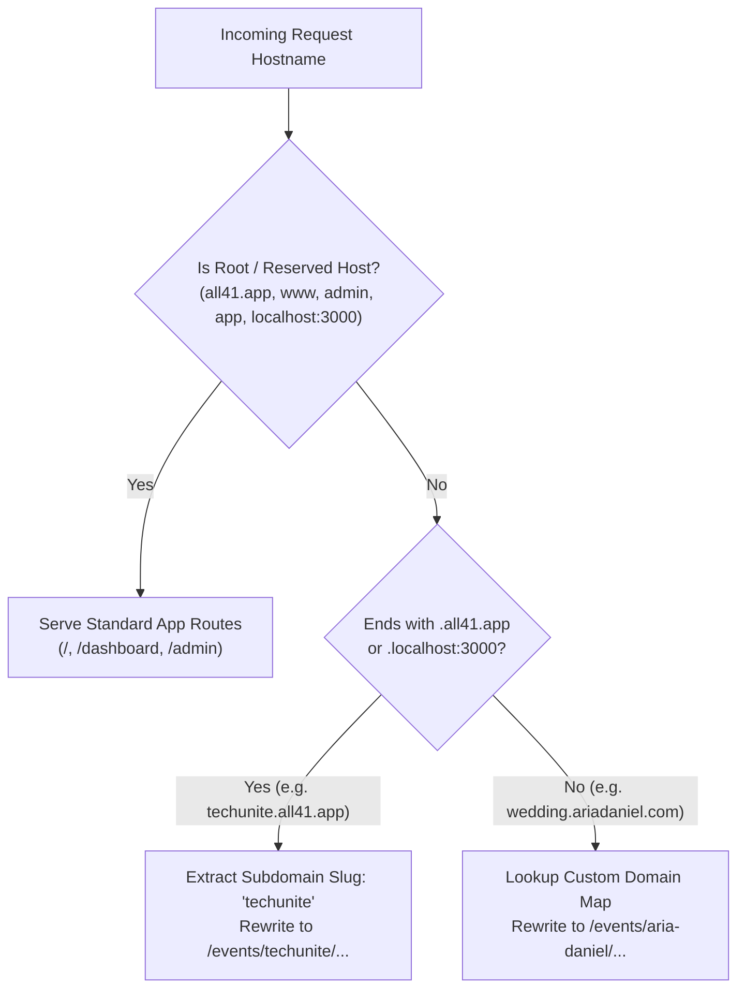

### Key Routing Rules in `src/proxy.ts` and `src/lib/domain.ts`:
1. **Reserved System Subdomains:** `www`, `app`, `dashboard`, `admin`, `api`, `auth`, `mail`, `cdn`, `stage` are never treated as client event slugs.
2. **Subdomain Rewrite:** When a guest visits `https://techunite.all41.app/photowall`, `src/proxy.ts` extracts `slug = 'techunite'` and transparently rewrites the request to `/events/techunite/photowall` while keeping `techunite.all41.app/photowall` in the user's browser address bar.
3. **Custom Domain (BYOD) Resolution:** When an event connects a custom DNS CNAME (`wedding.ariadaniel.com` → `cname.all41.app`), `src/proxy.ts` resolves the custom hostname to the corresponding `event.slug` (`aria-daniel`) and rewrites all paths seamlessly.

---
---

# [PAGE 20] COMPLETE DATABASE SCHEMA, SUPABASE RLS & REALTIME CHANNELS

## 20.1 Relational Database Schema (`supabase/migrations/0001_initial_schema.sql`)

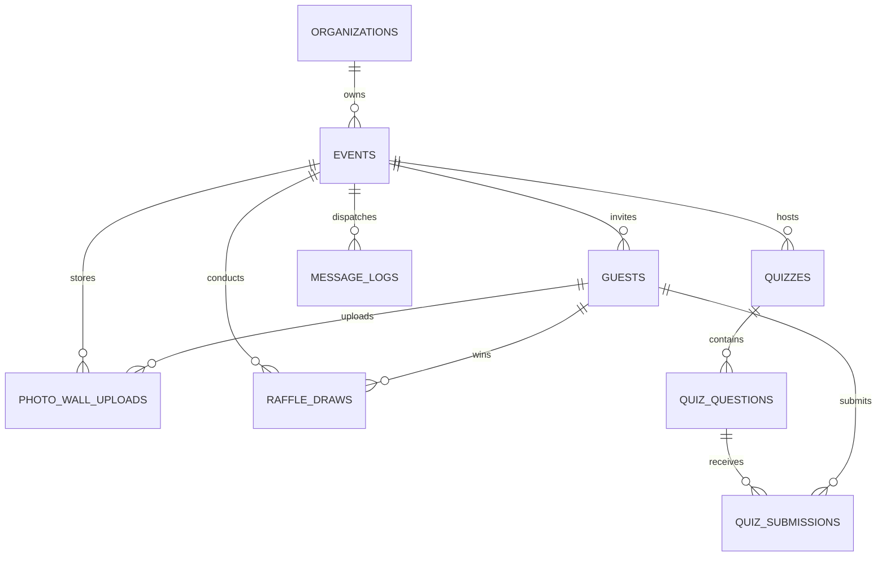

### Core PostgreSQL Tables Overview
1. **`organizations`**: `id (UUID PK)`, `name`, `slug (UNIQUE)`, `owner_id (UUID FK auth.users)`, `created_at`.
2. **`events`**:
   - Identity & Routing: `id (UUID PK)`, `organization_id (FK)`, `name`, `slug (TEXT UNIQUE)`, `custom_domain (TEXT UNIQUE NULL)`.
   - Classification & Schedule: `event_type ('corporate' | 'wedding' | 'conference' | 'concert' | 'other')`, `start_date (TIMESTAMPTZ)`, `end_date (TIMESTAMPTZ)`, `location_name`, `location_address`, `location_maps_url`, `status ('draft' | 'active' | 'completed' | 'cancelled')`.
   - JSONB Configurations: `theme_config (JSONB — ThemeConfig)`, `settings (JSONB — EventSettings including stageConfig, enablePhotoWallCaptions, maxCaptionLength: 300)`.
   - Retention Lifecycle: `media_purge_at (TIMESTAMPTZ — end_date + 30 days)`.
3. **`guests`**:
   - `id (UUID PK)`, `event_id (FK CASCADE)`, `name`, `email`, `phone`, `category (TEXT DEFAULT 'Regular')`, `table_number (TEXT NULL)`, `plus_one_count (INT DEFAULT 0)`.
   - `rsvp_status ('pending' | 'attending' | 'declined')`, `rsvp_notes`, `custom_fields (JSONB)`.
   - **Single Source of Truth Check-in & Quotas:** `qr_code_token (TEXT UNIQUE NOT NULL)`, `is_checked_in (BOOLEAN DEFAULT FALSE)`, `checked_in_at (TIMESTAMPTZ NULL)`, `checked_in_by (TEXT NULL)`, `photos_uploaded_count (INT DEFAULT 0 CHECK <= 10)`, `emails_sent_count (INT DEFAULT 0 CHECK <= 3)`, `whatsapp_sent_count (INT DEFAULT 0 CHECK <= 3)`.
4. **`photo_wall_uploads`**:
   - `id (UUID PK)`, `event_id (FK CASCADE)`, `guest_id (FK guests)`, `media_type ('image' | 'video')`, `image_url (TEXT)`, `video_url (TEXT NULL)`, `thumbnail_url (TEXT NULL)`, `caption (VARCHAR(300) NULL)`, `aspect_ratio ('portrait' | 'square' | 'landscape')`, `file_size_bytes (INT)`, `likes_count (INT DEFAULT 0)`, `is_approved (BOOLEAN DEFAULT FALSE)`, `created_at`.
5. **`raffle_draws`**:
   - `id (UUID PK)`, `event_id (FK CASCADE)`, `prize_name`, `prize_tier (INT)`, `style ('wheel' | 'claw' | 'slot')`, `winner_guest_id (FK guests)`, `is_claimed (BOOLEAN DEFAULT TRUE)`, `drawn_at (TIMESTAMPTZ)`.
6. **`quizzes`, `quiz_questions`, `quiz_submissions`**:
   - Stores quiz rounds, 4-quadrant options, correct option index, time limits, and guest answers with `response_time_ms` and `points_awarded`.

## 20.2 Supabase Row Level Security (RLS) & Realtime Channels
- **RLS Policies:**
  - Organizers can `SELECT / INSERT / UPDATE / DELETE` only rows where `event.organization_id` belongs to their authenticated `auth.uid()`.
  - Public Guest PWA can `SELECT` public event metadata and `INSERT / UPDATE` their own guest/upload rows only when accompanied by a valid `qr_code_token` and (`is_checked_in = true` for `photo_wall_uploads` and `quiz_submissions`).
- **Supabase Realtime Channels (`event:{eventId}`):**
  - `postgres_changes` on `photo_wall_uploads` (`is_approved = true`) → instantly pushes new photos to `/events/[slug]/photowall/live` and `/events/[slug]/stage`.
  - `broadcast` event `stage_config_update` → switches the active module on `/events/[slug]/stage` in `<100ms`.
  - `broadcast` event `quiz_state_change` → synchronizes question reveal and countdown timers across all connected guest phones at `/events/[slug]/play`.

---
---

# [PAGE 21] WHATSAPP MESSAGING ARCHITECTURE (`FONNTE BYON & INVISIBLE PACING`)

## 21.1 Clean Provider Abstraction (`src/lib/messaging/types.ts`)
Because WhatsApp uses **Fonnte (Bring Your Own Number / BYON)** today and will support the **Official Meta WhatsApp Business API** in a future release, all WhatsApp dispatches flow through a unified `MessagingProvider` interface:

```typescript
export interface MessagingPayload {
  eventId: string;
  guestId: string;
  recipientPhone: string;
  templateType: 'invitation' | 'rsvp_confirmation' | 'reminder' | 'qr_pass' | 'thank_you';
  variables: {
    name: string;
    eventName: string;
    eventDate: string;
    venueName: string;
    tableNumber?: string;
    qrPassUrl: string;
  };
}

export interface MessagingProvider {
  providerName: 'fonnte' | 'official_meta';
  checkConnectionStatus(deviceToken: string): Promise<{ connected: boolean; phoneNumber?: string }>;
  enqueueBroadcast(payloads: MessagingPayload[]): Promise<{ batchId: string; queuedCount: number }>;
}
```

## 21.2 Mandatory Fonnte BYON Risk Disclosure & Invisible Rate Limiting
Per explicit product governance rules:
1. **Bring Your Own Number (BYON):** Organizers connect their own dedicated event WhatsApp number by scanning a Fonnte QR code in `/dashboard/settings` or `/dashboard/events/[id]?tab=setting`.
2. **Mandatory Risk Disclosure Modal:** Before an organizer can link a Fonnte number or trigger a WhatsApp broadcast, they must check a mandatory consent box acknowledging that unofficial WhatsApp bridges carry a risk of number restriction/banning by Meta outside of all41.app's control.
3. **Invisible System Rate Limiting (Governed by T&C):**
   - **Crucial UX Rule:** The organizer **never** sees or configures technical delay sliders, jitter milliseconds, or batch sizes in the UI.
   - Behind the scenes, the backend queue worker automatically enforces anti-ban safety pacing:
     - **Randomized Inter-Message Jitter:** `5,000ms to 15,000ms` delay between each message.
     - **Batch Cooldown:** After every `40 messages`, the worker pauses for `180 seconds` before resuming.
     - **Quota Enforcement:** Maximum `3 WhatsApp messages per guest` per event.
   - In the public **Terms & Conditions (`/terms`)**, a dedicated clause states that message delivery rates are automatically throttled and paced by the system to protect sender numbers and platform integrity.

---
---

# [PAGE 22] ENGINEERING SKILLS, DEVELOPER TOOLS & ROOT `CLAUDE.MD` CONSTITUTION

To build, maintain, and scale **all41.app**, the engineering team and AI coding agents (Claude Code / Claude Desktop) rely on the following skill matrix, tooling stack, and root `CLAUDE.md` constitution.

## 22.1 Core Competency & Skill Matrix

| Skill Domain | Specific Technical Competencies Required | Where It Is Applied in `all41.app` |
| :--- | :--- | :--- |
| **1. Next.js 16 & React 19 Architecture** | App Router dynamic segments (`[id]`, `[slug]`), React `use()` hook for async params, Suspense boundaries, Server Actions, `src/proxy.ts` edge rewrites | Multi-tenant subdomain routing, 10-menu dashboard, SSR/CSR hybrid rendering |
| **2. Luxury UI & Tailwind CSS v4** | Tailwind v4 `@theme` custom tokens, CSS Masonry (`columns-*`), radial-gradient `.ticket-cutout` masks, keyframe animations (`.animate-scan-line`), responsive mobile PWA frames | Enforcing 100% adherence to `#09090B` black, `#C5A059` gold, `#00F0FF` neon, and `Outfit`/`Manrope` typography |
| **3. Browser Media, WebRTC & IndexedDB** | `navigator.mediaDevices.getUserMedia`, HTML5 `<canvas>` WebP compression (`canvas.toBlob('image/webp', 0.82)`), `IndexedDB` offline caching, `navigator.share` | Gate QR camera scanner + offline ballroom cache, Guest PWA selfie/720p video capture (`≤2MB` WebP) |
| **4. Realtime Distributed Systems** | Supabase Realtime (`postgres_changes`, `broadcast`, `presence`), optimistic UI updates, low-latency state machines, reconnection recovery on flaky ballroom Wi-Fi | Live Trivia Blitz buzzer sync (`<100ms`), Stage LED 7-module switching, live Photo Wall streaming |
| **5. Cloud Storage & Lifecycle Ops** | AWS S3 SDK v3 (`PutObjectCommand`, `getSignedUrl`), Cloudflare R2 CORS policies, S3 Object Lifecycle Rules (`Expiration: 30 days`), streaming ZIP archive generation | Storing guest WebP photos & 720p videos, zero-egress stage streaming, automated 30-day post-event purge |

## 22.2 Root `CLAUDE.md` Constitution (`/Users/drew83/Projects/all41/CLAUDE.md`)
Claude Code automatically reads `/Users/drew83/Projects/all41/CLAUDE.md` at the beginning of every session:

```markdown
# CLAUDE.MD — ALL41.APP AI ENGINEERING CONSTITUTION

## 1. Project Identity & Commands
- **Project:** all41.app — Luxury All-in-One Event Experience Platform (Corporate Summits & Luxury Weddings).
- **Root Path:** `/Users/drew83/Projects/all41`
- **Dev Server:** `pnpm dev` (Runs Next.js 16.4.2 Turbopack on `http://localhost:3000`)
- **Typecheck (MANDATORY before finishing any task):** `pnpm tsc --noEmit`
- **Production Build Verification:** `pnpm build`
- **Next.js 16 Convention:** Use `src/proxy.ts` (NOT `middleware.ts`). In dynamic pages (`[id]`, `[slug]`), `params` is a `Promise<{ id: string }>`—unwrap it with `React.use(params)` inside a `<Suspense>` boundary.

## 2. Non-Negotiable Brand Design System Rules
NEVER use generic Tailwind blue/indigo/slate palettes (`bg-blue-600`, `bg-indigo-500`, `bg-slate-900`, `#0f1320`) or unapproved gold hexes (`#dfb76c`).
ALWAYS use the official `@theme` tokens defined in `src/app/globals.css`:
- **Backgrounds:** `bg-premium-black` (`#09090B`), `bg-premium-charcoal` (`#18181B`), `bg-premium-surfaceDark` (`#121214`)
- **Borders:** `border-premium-borderDark` (`#27272A`), active/highlight `border-premium-gold/50`
- **Accents:** `bg-premium-gold` / `text-premium-gold` (`#C5A059`), hover `bg-premium-goldHover` (`#B38E46`), `text-premium-neon` (`#00F0FF`), `text-premium-danger` (`#FF3366`), `text-premium-success` (`#00E676`)
- **Typography:** Headings MUST use `font-display` (`Outfit`, tracking `-0.02em`). Body copy uses `font-sans` (`Manrope`). Technical tokens/URLs use `font-mono`.
- **Interactive Tactility:** Every button, clickable card, and tab pill MUST include `scale-on-click`. Gold primary buttons use `bg-premium-gold text-black font-bold shadow-gold scale-on-click`.
- **Brand Mark:** The circular gold badge `<div className="w-10 h-10 bg-premium-gold rounded-full flex items-center justify-center text-premium-black font-display font-bold">41</div>`.
- **Card Radii:** Major containers use `rounded-[2rem]` or `rounded-[2.5rem]`. Inputs/buttons use `rounded-xl` or `rounded-2xl`.

## 3. Core Product Invariants & Sequencing Priority
1. **Dual Theme Engine:** Events are partitioned into `corporate` (`CORPORATE_THEMES`) and `wedding` (`WEDDING_THEMES`). Never mix their landing page schemas (`corporate_keynote` vs `wedding_romance`).
2. **Luma/Typeform Creation -> 10-Menu Dashboard:** `/dashboard/events/new` is a <60s creation studio. All modules are configured post-creation inside `/dashboard/events/[id]` across the 10 menus: `Overview`, `Guests`, `Registrations`, `Broadcast`, `Games`, `Door Prize`, `Photos`, `Insights`, `LIVE`, `Setting`.
3. **Check-in Gated Interactivity:** Day-of modules (Photo Wall uploads, Trivia Blitz, 3D Raffle) require a valid guest `qr_code_token` with `is_checked_in === true`.
4. **Core Platform First:** Focus 100% on the platform builders, QR attendance, games, raffles, and stage LED. Pricing, commissions, and payment integrations are deferred to the final phase.
```

---
---

# [PAGE 23] CLAUDE DESIGN-TO-CODE BLUEPRINTS (`100% BRAND COMPLIANCE`)

When using Claude (Claude 3.7 / Claude 4 Sonnet / Opus or Claude Code) to design new UI components or refactor existing screens, follow this **Design-to-Code Protocol** so Claude never drifts into generic AI UI patterns.

## 23.1 The "Anti-Generic AI UI" Guardrails for Claude
By default, LLMs trained on public GitHub repositories tend to output white backgrounds, `bg-indigo-600` buttons, `rounded-md` corners, and `Inter` fonts. To override this bias completely:

1. **Always Reference the Golden Master HTML Kit:** Point Claude to `/Users/drew83/.gemini/antigravity/brain/13ba6169-7a28-409a-af0c-142846ef1b44/.user_uploaded/media_1792567327203_13d9d26e.html` and [`src/app/globals.css`](file:///Users/drew83/Projects/all41/src/app/globals.css) as the ground truth.
2. **Enforce the Component Anatomy Blueprint:** Every card, modal, table, and button generated by Claude must follow these exact structural patterns:

### Blueprint A: Luxury Bento Card Container
```tsx
<div className="p-6 sm:p-8 rounded-[2.5rem] bg-premium-charcoal border border-premium-borderDark hover:border-premium-gold/50 transition-all shadow-2xl space-y-6">
  <div className="flex items-center justify-between border-b border-premium-borderDark pb-4">
    <div>
      <span className="text-[10px] font-mono uppercase tracking-widest text-premium-gold font-bold">
        Section Eyebrow
      </span>
      <h3 className="text-2xl font-display font-bold text-white mt-0.5">
        Card Title in Outfit Display
      </h3>
    </div>
    <span className="inline-flex items-center gap-1.5 px-3 py-1 rounded-full bg-premium-success/15 text-premium-success border border-premium-success/30 text-xs font-bold">
      <span className="w-2 h-2 rounded-full bg-premium-success animate-pulse" />
      Live Active
    </span>
  </div>
  {/* Card Body Content */}
</div>
```

### Blueprint B: Primary Gold CTA vs. Secondary Surface Button
```tsx
{/* Primary Gold CTA */}
<button
  type="button"
  className="px-6 py-3.5 rounded-2xl bg-premium-gold hover:bg-premium-goldHover text-black font-display font-bold text-xs shadow-gold scale-on-click transition-all flex items-center justify-center gap-2"
>
  <span>Primary Action</span>
</button>

{/* Secondary Dark Surface Button */}
<button
  type="button"
  className="px-5 py-3 rounded-2xl bg-premium-surfaceDark border border-premium-borderDark hover:border-premium-gold text-white font-bold text-xs scale-on-click transition-all"
>
  <span>Secondary Action</span>
</button>
```

### Blueprint C: Instant State-Driven Tab Switcher (No Router Lag)
Whenever Claude builds a multi-tab view in Next.js 16 App Router, instruct it to use **local React state synchronized with URL query params** rather than relying solely on `router.push(?tab=...)`:
```tsx
const searchParams = useSearchParams();
const [activeTab, setActiveTab] = useState(searchParams.get('tab') || 'overview');

const handleTabChange = (tabId: string) => {
  setActiveTab(tabId);
  router.push(`${pathname}?tab=${tabId}`, { scroll: false });
};
```

---
---

# [PAGE 24] CLAUDE PROMPT PLAYBOOKS, SECURITY, CODEBASE MAP & PHASED ROADMAP

## 24.1 Step-by-Step Claude Prompt Playbooks for Core Platform Modules

### Playbook 1: Connecting Live Supabase Persistence & Builder Schemas
> **Prompt to Claude:**  
> *"Read `CLAUDE.md`, `src/lib/types.ts`, and `src/app/dashboard/events/[id]/page.tsx`. Connect the Landing Page Builder, Typeform Invitation Form Builder, `guestsList`, `registrations`, and `photosList` to live Supabase PostgreSQL tables (`events`, `guests`, `photo_wall_uploads`) using `@supabase/ssr`. Subscribe to channel `event:${eventId}` for real-time updates on `guests` (`is_checked_in`) and `photo_wall_uploads` (`is_approved`). Preserve 100% of the existing Master Brand UI Kit classes (`bg-premium-charcoal`, `rounded-[2.5rem]`, `text-premium-gold`) and verify with `pnpm tsc --noEmit`."*

### Playbook 2: Wiring Cryptographic QR Generator, Gate Scanner Offline Cache & Check-in Sync
> **Prompt to Claude:**  
> *"Read `CLAUDE.md`, `src/app/dashboard/events/[id]/checkin/page.tsx`, and `src/app/events/[slug]/pass/page.tsx`. Implement cryptographic HMAC token generation (`QR-ALL41-{SLUG}-{HEX}-{HMAC4}`) whenever a guest is added or approved from the `Registrations` queue. On `/checkin`, prefetch the event's guest roster into browser `IndexedDB` so QR validation works in `<10ms` even if ballroom Wi-Fi drops, handling 3 states: (1) First-time admission (`is_checked_in = true` + VIP/Table callout), (2) Duplicate scan warning with original check-in timestamp, and (3) Invalid token. Broadcast `guest_checked_in` over Supabase Realtime channel `event:${eventId}`."*

### Playbook 3: Connecting Attendance to Live Trivia Blitz (`/games` & `/play`) & 3D Raffle (`/raffle`)
> **Prompt to Claude:**  
> *"Read `CLAUDE.md`, `src/app/events/[slug]/games/page.tsx`, `src/app/events/[slug]/play/page.tsx`, and `src/app/events/[slug]/raffle/page.tsx`. Enforce the check-in gate (`guest.is_checked_in === true`) before allowing quiz submissions or entering the 3D Raffle draw pool. Synchronize the Operator Cockpit (`src/app/dashboard/events/[id]/operator/page.tsx`) with `/games`, `/play`, `/raffle`, and `/stage` over Supabase Realtime `broadcast` events (`QUIZ_QUESTION_START`, `QUIZ_REVEAL`, `RAFFLE_SPIN_START`, `STAGE_MODULE_CHANGE`), using `crypto.getRandomValues()` for CSPRNG raffle winner selection and millisecond speed-weighted scoring for trivia."*

### Playbook 4: Wiring Presigned Cloudflare R2 Media Uploads & Email/WA Reminder Builder
> **Prompt to Claude:**  
> *"Read `CLAUDE.md`, `src/app/events/[slug]/page.tsx`, and `src/app/dashboard/events/[id]/page.tsx` (Broadcast tab). (1) Create `src/app/api/events/[slug]/upload-url/route.ts` using `@aws-sdk/client-s3` to issue presigned Cloudflare R2 PUT URLs for checked-in guests (`image/webp <= 2MB`, `video/mp4 <= 20MB`, max 10 uploads/guest, optional caption `<= 300 chars`). (2) Wire the Email Builder (`Resend`) to dispatch dark-and-gold HTML emails with inline QR Pass PNGs and `.ics` calendar attachments for `VIP Invitation`, `RSVP Confirmation`, `24h Reminder`, and `Thank You`, alongside the Fonnte BYON background queue worker with automatic `5–15s` anti-ban pacing."*

## 24.2 Security, Data Privacy (UU PDP / PDPA) & Anti-Spam Resilience

| Operational Scenario | System Guardrail & Technical Enforcement |
| :--- | :--- |
| **Uninvited QR / Photo Wall Spam** | Uploading to the Photo Wall or joining Trivia/Raffle strictly requires a valid `qr_code_token` where `is_checked_in === true` + Operator moderation queue approval (`is_approved`). |
| **Screenshot / Duplicate QR Sharing at Entrance** | Gate Scanner (`/checkin`) immediately flags any token where `is_checked_in === true`, displaying the exact timestamp and gate desk of the first scan. |
| **Ghost Winners in Door Prize Raffles** | The 3D Raffle engine queries `WHERE is_checked_in = true AND id NOT IN (claimed_winners)`, guaranteeing every drawn winner is physically inside the venue and has not won twice. |
| **Ballroom Dead-Zone Wi-Fi Dropouts** | Gate Scanner (`/checkin`) caches the event's `guests` token list in `IndexedDB` on load, enabling sub-second (`<10ms`) offline QR validation that syncs back to Supabase when connectivity resumes. |
| **30-Day Media Privacy Lifecycle (UU PDP / PDPA)** | All guest media in Cloudflare R2 (`events/{eventId}/media/*`) is automatically purged 30 days after `event.end_date` via S3 Object Expiration rules, with organizer ZIP export reminders at Day +23 and Day +28. |

## 24.3 Phased Engineering Roadmap (`Core Platform First — Pricing & Payments Last`)

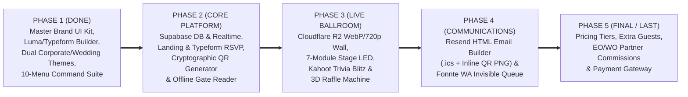

> [!IMPORTANT]
> **Strict Sequencing Rule:** Phases 1 through 4 deliver the complete, end-to-end **all41.app** event experience platform. **Phase 5 (Pricing, Commissions, and Payment Integrations)** is intentionally executed **last** once all core event builders, attendance scanners, games, raffles, and stage displays are 100% finalized.

## 24.4 Complete Repository File Tree & `.env.local` Reference

```text
/Users/drew83/Projects/all41/
├── CLAUDE.md                                     # AI Engineering Constitution & Brand Guardrails
├── ALL41_MASTER_BLUEPRINT.md                     # This 24-Page Complete Platform Reference
├── package.json                                  # Next.js 16.4.2, React 19.3, Supabase, AWS R2, Resend
├── next.config.ts                                # Next.js & Turbopack configuration
├── tsconfig.json                                 # Strict TypeScript 5 configuration
└── src/
    ├── proxy.ts                                  # Next.js 16 Multi-Tenant Subdomain & BYOD Edge Proxy
    ├── app/
    │   ├── globals.css                           # Tailwind v4 @theme tokens & Master Brand utilities
    │   ├── layout.tsx                            # Root layout (Outfit & Manrope fonts, #09090B canvas)
    │   ├── page.tsx                              # Public Marketing Landing Page (all41.app)
    │   ├── manifest.ts                           # PWA Web App Manifest
    │   ├── terms/page.tsx                        # Terms & Conditions (includes invisible WA rate limit clause)
    │   ├── privacy/page.tsx                      # Privacy Policy (UU PDP / PDPA & 30-day R2 retention)
    │   ├── admin/
    │   │   ├── page.tsx                          # Super Admin Overview & Tenant Telemetry
    │   │   ├── payouts/page.tsx                  # Partner Verification (Deferred to Final Phase)
    │   │   └── whatsapp/page.tsx                 # Global Fonnte BYON Queue & Pacing Monitor
    │   ├── dashboard/
    │   │   ├── layout.tsx                        # Dashboard shell with context-aware Sidebar
    │   │   ├── page.tsx                          # Workspace Overview & Managed Events Grid
    │   │   ├── themes/page.tsx                   # Categorized Corporate (4) vs Wedding (4) Theme Catalog
    │   │   ├── referrals/page.tsx                # Partner Program View (Deferred to Final Phase)
    │   │   ├── settings/page.tsx                 # Global Integrations (Domain, R2, Resend, Fonnte)
    │   │   └── events/
    │   │       ├── new/page.tsx                  # Luma + 6-Step Typeform Event Creation Studio
    │   │       └── [id]/
    │   │           ├── page.tsx                  # 10-Menu Unified Event Command Suite (Overview..Setting)
    │   │           ├── guests/page.tsx           # Standalone Detailed Guest Roster & VIP Pass Manager
    │   │           ├── checkin/page.tsx          # Gate Camera QR Scanner with Gold Brackets & Laser Line
    │   │           └── operator/page.tsx         # 4-Tab Crew Operator Cockpit (Gate, Wall, Quiz, Raffle)
    │   └── events/
    │       └── [slug]/
    │           ├── page.tsx                      # Guest Mobile PWA (Dual Corporate/Wedding Schema + Angpao)
    │           ├── pass/page.tsx                 # Standalone Digital VIP Ticket Pass (.ticket-cutout)
    │           ├── play/page.tsx                 # 4-Quadrant Live Trivia Mobile Buzzer Pad
    │           ├── photowall/
    │           │   ├── page.tsx                  # Guest Photo & 720p Video Uploader + Gallery
    │           │   └── live/page.tsx             # Fullscreen Animated Masonry Photo Wall Broadcast
    │           ├── games/page.tsx                # Big Screen Kahoot-Style Trivia Arena & Podium
    │           ├── raffle/page.tsx               # Big Screen 3D Raffle (Slot / Wheel / Claw) + Audit Log
    │           └── stage/page.tsx                # Ballroom Stage LED 7-Module Master Display + Ticker
    ├── components/
    │   ├── dashboard/
    │   │   ├── Sidebar.tsx                       # Context-aware Sidebar (Workspace vs 10 Event Menus + Live Rails)
    │   │   ├── Header.tsx                        # Glassmorphic Dashboard Top Header
    │   │   └── StageLedEditor.tsx                # 7-Module Ballroom Stage LED Configuration Editor
    │   ├── events/
    │   │   └── PinterestMasonryPhotoWall.tsx     # Multi-column Pinterest Masonry Grid + Lightbox + Share/Download
    │   └── marketing/
    │       ├── Navbar.tsx                        # Marketing Top Nav with Circular 41 Gold Badge
    │       ├── Hero.tsx                          # Luxury Hero with UI Kit Preview Cards
    │       ├── FeatureShowcase.tsx               # 8-Module Product Architecture Showcase
    │       └── Footer.tsx                        # Brand Footer
    └── lib/
        ├── types.ts                              # Master TypeScript Interfaces (Event, Guest, ThemeConfig, etc.)
        ├── domain.ts                             # Subdomain (<slug>.all41.app) & BYOD Domain Parser
        ├── mockData.ts                           # Rich Corporate (TechUnite) & Wedding (Aria & Daniel) Mock Data
        ├── utils.ts                              # cn(), formatDate() utilities
        └── theme/
            └── defaultThemes.ts                  # CORPORATE_THEMES (4) & WEDDING_THEMES (4) + Landing Schemas
```
