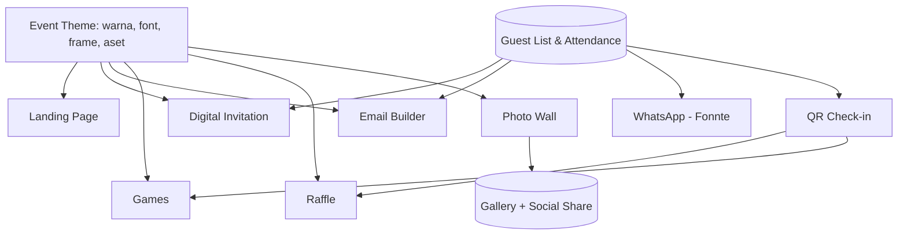

# Context Profile: all41.app

> Nama platform: **all41.app** (di dokumen ini disebut "the Platform")
> Versi dokumen: 3.0 (Final Pre-Development) | Tanggal: 21 Okt 2026
> Perubahan v3.0: dikunci **Tech Stack** (Next.js + TypeScript + Tailwind + Supabase + Cloudflare R2 + Resend + Vercel), **urutan pengerjaan development** (Website/Home + Dashboard + seluruh modul inti lebih dulu; Xendit & Fonnte dikerjakan terakhir via menu Settings), **akses fitur Hari-H wajib terhubung ke QR Guest List yang sudah check-in di lokasi**, dan **pencairan cashback referral manual setelah event selesai** di tahap awal.
> Perubahan v2.7: pengaturan teknis **rate limit & jeda pesan dijalankan otomatis oleh sistem di belakang layar** (user tidak perlu tahu/mengatur); cukup dicantumkan di **Terms & Conditions (T&C)** bahwa rate limit dibatasi oleh sistem demi keamanan.
> Perubahan v2.6: dikunci penggunaan **Fonnte untuk saat ini** (dengan skema **Bring Your Own Number / BYON** dan **mandatory Risk Disclosure**) serta **WhatsApp Business API resmi sebagai opsi premium di masa mendatang**.
> Perubahan v2.5: besaran cashback ditetapkan berdasarkan jumlah tamu akhir (**10% = 100+, 12% = 500+, 15% = 1.000+, 18% = 2.000+**) dan **dihitung setelah event selesai**.
> Perubahan v2.4: syarat cashback berdasarkan **jumlah tamu minimal 100** (bukan tier paket), berlaku untuk semua paket berbayar termasuk Starter dengan extra guest.
> Perubahan v2.3: extra guest hanya **kelipatan 10 tamu**; Free dan Scale tidak bisa menambah tamu; cashback referral dihitung dari **paket + extra guest**.
> Perubahan v2.2: harga add-on WhatsApp dipisah per provider: **Fonnte** (Rp 50rb / 250rb / 400rb / 800rb / 1,2jt) dan **WhatsApp resmi** (Rp 100rb / 300rb / 600rb / 1,5jt / 2,5jt), mengikuti paket Starter sampai Scale.
> Perubahan v2.1: ditambahkan **Extra Guest**: tambahan tamu dengan harga per tamu sesuai tier paket (Rp 3.000 / 2.500 / 2.250 / 2.000), minimal tambahan 10 tamu, per event.
> Perubahan v2.0: harga Business menjadi **Rp 3jt (s/d 1.500)** dan Scale **Rp 4,5jt (s/d 2.500)**. Struktur akhir: Rp 150rb (s/d 50), Rp 750rb (s/d 300), Rp 1,35jt (s/d 600), Rp 3jt (s/d 1.500), Rp 4,5jt (s/d 2.500), di atas 2.500 contact us. Nominal cashback disesuaikan.
> Perubahan v1.9: **struktur paket diubah menjadi 5 paket berbayar**: Rp 150rb (s/d 50), Rp 750rb (s/d 300), Rp 1,35jt (s/d 600), Rp 2,5jt (s/d 1.500), Rp 3,5jt (s/d 2.500), di atas 2.500 contact us. Tabel cashback dan kuota/harga add-on WhatsApp disesuaikan.
> Perubahan v1.8: harga paket dinaikkan (struktur 4 paket: 250rb / 850rb / 1,8jt / 3jt), digantikan oleh v1.9.
> Perubahan v1.7: aturan cashback referral: 10-20% (usulan berjenjang) hanya untuk event di atas 100 tamu, minimum pencairan Rp 100.000, hanya agency / EO / WO sebagai referrer, klien tidak mendapat diskon.
> Perubahan v1.6: referral code = tracking + **cashback untuk referrer**; add-on WhatsApp dan White Label per event (butuh setup teknis dan waktu); Xendit terkonfirmasi untuk Asia Tenggara; paket Free maks. **1 event aktif per akun**.
> Perubahan v1.5: fair-use limit ditetapkan (WebP, maks. 2MB per upload, 10 upload per tamu, email 3x per tamu); harga dasar IDR (konversi ke IDR); Free per event; referral code untuk identifikasi event dari agency / EO / WO; usulan harga add-on WhatsApp dan cakupan white label.
> Perubahan v1.4: WhatsApp (Fonnte) dipisah menjadi **add-on berbayar**; add-on **White Label / Bring Your Own Domain +Rp 250rb**; payment via **Xendit**; bahasa produk saat ini **English**; brand: modern, colorful neon & dark gold; kontak info@all41.app.
> Perubahan v1.3: tidak ada paket lebih kecil dari Rp 200rb; email dan penyimpanan inklusif (storage s/d 30 hari); open access lewat contact us (email).
> Perubahan v1.2: pricing diganti menjadi **paket flat per batas jumlah tamu** (Rp 200rb / 750rb / 1,5jt / 3jt, di atas 3.000 tamu contact us).

---

## 1. Ringkasan Singkat

Platform **all-in-one event experience** untuk **corporate event** dan **wedding**. Platform ini mencakup seluruh siklus acara dalam satu tempat:

**Sebelum acara:** landing page, undangan digital, email, WhatsApp blast (add-on), RSVP.
**Saat acara:** check-in, games interaktif, door prize, photo wall.
**Setelah acara:** galeri foto, konten sosial media, data kehadiran.

**Value proposition:** Satu platform, satu tema visual, dari undangan sampai after-event. Harga *paket flat* yang transparan berdasarkan kapasitas tamu, dan gratis sampai 5 tamu.

**Tagline utama:** *"Everything you need for your event."*
**Tagline alternatif:** *"Make every guest part of the show."*

### Brand & Bahasa
- **Makna nama:** all41 = semua yang Anda butuhkan untuk event Anda, dalam satu platform.
- **Karakter visual:** **modern, colorful neon, dan dark gold**. Dasar gelap (dark) dengan aksen neon berwarna dan sentuhan emas gelap (dark gold) untuk kesan premium.
- **Bahasa produk saat ini:** **English** (UI, template, dan komunikasi). Bahasa lokal ditambahkan bertahap sesuai kebutuhan klien.
- **Kontak:** info@all41.app (sales, open access, enterprise, dan support).

> [!NOTE]
> Tema neon dan dark gold cocok untuk corporate gala, launch, dan konsep party. Untuk wedding yang lebih lembut / elegan, sediakan **template tema terang** (ivory, blush, gold) agar fleksibel. Platform sebagai brand tetap neon dan dark gold, sedangkan tema event milik klien bebas.

---

## 2. Target Market & Persona

| Segmen | Kebutuhan utama | Pain point | Fitur kunci |
|---|---|---|---|
| **Perusahaan (HR / Marketing / Corporate Comms)** | Gathering, product launch, townhall, annual dinner, gala | Banyak tool terpisah, engagement rendah, sulit rekap data | Games, door prize, photo wall berbrand, guest list & check-in, email |
| **Event Organizer (EO)** | Mengelola banyak klien dan event paralel | Biaya tool menumpuk, kurang white-label, repetitif | Template reuse, multi-event, branding klien, harga paket yang bisa diprediksi |
| **Wedding Organizer (WO) / Couple** | Undangan estetik, RSVP, hiburan resepsi | Undangan WA manual, RSVP berantakan, photo booth mahal | Undangan digital, RSVP, WA via Fonnte, photo wall, door prize/games |

**Persona contoh**
- **Rina (WO, Jakarta):** 8 pernikahan per bulan. Butuh template cepat, kirim WA massal, rekap RSVP otomatis.
- **Budi (HR Manager, Surabaya):** Annual gathering 600 karyawan. Butuh check-in cepat, undian hadiah, dan games seru.
- **Aisha (EO, Kuala Lumpur):** Corporate launch untuk klien. Butuh white-label, photo wall bertema brand, dan laporan data.

**Area:** Global, dengan fokus **Asia Tenggara** (Indonesia sebagai pasar awal / beachhead, lalu MY, SG, TH, PH, VN).

---

## 3. Modul Produk

### 3.1 Landing Page Builder
- Drag-and-drop dengan template per kategori (wedding, corporate, conference, gala).
- Blok: hero, countdown, rundown/agenda, lokasi + peta, galeri, RSVP, sponsor, FAQ.
- Subdomain bawaan (`namaevent.all41.app`); **custom domain (bring your own domain) lewat add-on White Label**. SEO dasar, mobile-first.
- Tema dan palet warna disimpan sebagai **Event Theme** yang dipakai ulang di semua modul.

### 3.2 Digital Invitation Form
- Undangan personal per tamu (link unik dan QR).
- Form RSVP: hadir / tidak, jumlah pendamping, preferensi makanan, ucapan.
- Custom field (corporate: divisi, ukuran seragam, dll).
- Bahasa: **English** saat ini. Arsitektur i18n disiapkan agar bahasa lain (ID, MS, TH, VI, FIL) bisa ditambah kemudian.

### 3.3 Email Builder
- Editor visual untuk undangan, reminder, thank-you, dan survei.
- Variabel personalisasi (`{{nama}}`, `{{meja}}`, `{{qr}}`).
- Penjadwalan, segmentasi (VIP, keluarga, tim), tracking open/click.

### 3.4 Guest List & Attendance
- Import CSV/Excel, tambah manual, grup/tag/kategori, nomor meja.
- Status: invited → sent → opened → RSVP → checked-in.
- **Check-in via scan QR** (staf, lewat PWA/web), plus mode offline-tolerant.
- Dashboard kehadiran real-time dan export laporan.

### 3.5 Games (gaya Kahoot, scavenger hunt, dll)
- **Akses peserta:** wajib terhubung dengan **QR Guest List** dan **sudah berstatus hadir (checked-in) di lokasi**.
- **Live quiz** (host screen + HP peserta, leaderboard real-time).
- **Scavenger hunt** (misi berbasis QR / foto / lokasi, poin otomatis).
- Ide lanjutan: trivia pasangan ("How well do you know the couple?"), bingo, polling / word cloud, team challenge, spin-the-question.
- Mode: layar besar (projector) + perangkat tamu, tanpa instal aplikasi (web-based).

### 3.6 Door Prize / Raffle
> Catatan: istilah di brief ditulis "ruffle", di dokumen ini dibakukan menjadi **raffle**.

- Gaya undian: **Wheel of Spin**, **Claw Machine**, slot machine, gacha capsule, kartu gosok, bola lotto, dan lainnya.
- Pool peserta diambil dari data tamu di Guest List **yang sudah check-in di lokasi** (adil dan anti-curang).
- Aturan: pemenang tidak boleh menang dua kali, hadiah bertingkat, undi ulang bila tidak hadir.
- Tampilan layar besar dengan animasi dan suara, tema mengikuti Event Theme.
- Log hasil undian sebagai audit trail.

### 3.7 Photo Wall (pengganti / pelengkap photo booth)
**Alur:**
1. Tamu yang **sudah check-in di lokasi** membuka akses Photo Wall (terhubung dengan **QR unik Guest List** milik tamu).
2. Browser membuka **kamera langsung** (tanpa instal aplikasi).
3. Sistem menampilkan **frame dan filter yang sesuai tema** event.
4. Foto diambil, lalu **otomatis ter-upload** ke event gallery (kuota terikat ke ID tamu di Guest List).
5. Foto tampil di **Live Photo Wall** (layar besar) dan bisa **dibagikan ke sosial media** (IG, WhatsApp, TikTok, Facebook, dll).

**Fitur:**
- Frame dan stiker custom per event (generated / template).
- Filter: color grading, face stickers / AR ringan, background, tema musiman.
- Moderasi (auto dan manual) sebelum tampil di layar.
- Download, share link, watermark opsional (branding event / sponsor).
- Album pasca-acara yang bisa dibagikan ke semua tamu.
- **Batas upload:** otomatis dikonversi ke **WebP**, **maks. 2 MB per upload**, **maks. 10 upload per tamu**. Kompresi dilakukan di sisi klien sebelum upload.
- Dukungan foto, GIF/boomerang, dan video pendek (fase lanjut).

### 3.8 WhatsApp Integration (Fonnte) - **Add-on berbayar**
> **Keputusan:** WhatsApp **tidak termasuk** dalam paket, dijual sebagai **add-on terpisah**. Untuk saat ini memakai **Fonnte** dengan skema **Bring Your Own Number (BYON)** disertai **Risk Disclosure wajib**, sedangkan **WhatsApp Business API resmi** akan hadir sebagai opsi **premium** di masa mendatang. Layer provider dibuat sederhana (`MessagingProvider` interface) agar penambahan API resmi nanti mudah. Tanpa add-on, undangan dikirim lewat **email dan link/QR** (yang bisa dibagikan manual oleh host).

- **Bring Your Own Number (BYON) & Risk Disclosure:** Klien menghubungkan nomor WhatsApp milik sendiri melalui scan QR Fonnte di dashboard all41. Sebelum menghubungkan nomor dan menjalankan blast, klien **wajib menyetujui Risk Disclosure & Terms and Conditions (T&C)** bahwa koneksi pihak ketiga tidak resmi memiliki risiko pembatasan/blokir nomor oleh pihak WhatsApp/Meta di luar kendali all41.app, serta menyetujui bahwa **laju pengiriman (rate limit) diatur dan dibatasi otomatis oleh sistem** demi menjaga keamanan nomor.
- Kirim undangan, reminder, QR tiket, dan thank-you via WhatsApp.
- Blast terjadwal dengan template pesan dan variabel personalisasi.
- **Rate limiting dan jeda otomatis oleh sistem (invisible to user):** diatur sepenuhnya di belakang layar (anti-spam / anti-banned) tanpa perlu dikonfigurasi atau diketahui teknisnya oleh user.
- Status pengiriman tercatat di guest list.
- Balasan masuk (RSVP via balasan) sebagai fase lanjut.

---

## 4. Pricing Model

**Model: paket flat berdasarkan batas jumlah tamu terundang** (bukan per tamu). Harga ditentukan oleh paket terkecil yang mencukupi jumlah tamu di guest list.

| Paket | Kapasitas (tamu terundang) | Harga | Setara per tamu (di batas atas) |
|---|---|---|---|
| **Free** | s/d 5 tamu | **Gratis** | - |
| **Starter** | s/d 50 tamu | **Rp 150.000** | Rp 3.000 |
| **Plus** | s/d 300 tamu | **Rp 750.000** | Rp 2.500 |
| **Pro** | s/d 600 tamu | **Rp 1.350.000** | Rp 2.250 |
| **Business** | s/d 1.500 tamu | **Rp 3.000.000** | Rp 2.000 |
| **Scale** | s/d 2.500 tamu | **Rp 4.500.000** | Rp 1.800 |
| **Enterprise** | di atas 2.500 tamu | **Hubungi kami (contact us)** | Custom |

**Satuan hitung:** jumlah **tamu yang diundang** (yang ada di guest list), bukan yang hadir. Harga dan paket Free berlaku **per event**.

**Aturan paket Free:** maksimal **1 event aktif (on going) per akun**. Akun baru bisa membuat event Free baru setelah event Free sebelumnya selesai. Event berbayar tidak dibatasi.

### Contoh

| Tamu di guest list | Paket | Biaya |
|---|---|---|
| 5 | Free | Rp 0 |
| 6 | Starter | Rp 150.000 |
| 50 | Starter | Rp 150.000 |
| 51 | Plus | Rp 750.000 |
| 300 | Plus | Rp 750.000 |
| 301 | Pro | Rp 1.350.000 |
| 600 | Pro | Rp 1.350.000 |
| 601 | Business | Rp 3.000.000 |
| 1.500 | Business | Rp 3.000.000 |
| 1.501 | Scale | Rp 4.500.000 |
| 2.500 | Scale | Rp 4.500.000 |
| 2.501+ | Enterprise | Custom quote |

### Dampak desain paket ini
- **Kelebihan:** harga mudah dipahami dan diprediksi, tanpa cliff (harga selalu naik atau tetap saat tamu bertambah), mudah dijual ke klien oleh EO / WO, dan sederhana untuk billing. Batas 50 / 300 / 600 / 1.500 / 2.500 mengikuti ukuran event yang umum (intimate, wedding, gala, townhall besar).
- **Efek "tangga":** menambah 1 tamu di atas batas (misal tamu ke-51) menaikkan harga dari Rp 150.000 ke Rp 750.000 (lompatan terbesar, 5x), kecuali klien memilih membeli **extra guest** (lihat bagian Extra Guest). Perlu UX yang jelas: tampilkan indikator kapasitas ("38 / 50 tamu") dan saran upgrade atau extra guest.
- **Event kecil di bawah 50 tamu** tetap membayar Rp 150.000 (acara 10 tamu sama dengan acara 50 tamu). **Keputusan:** paket berbayar terkecil adalah Rp 150.000.
- **Nilai terbaik** ada di batas atas tiap paket, sehingga paket yang lebih tinggi lebih menarik bagi event yang mendekati kapasitas.

### Extra Guest (tambahan tamu di luar kapasitas paket)

Klien bisa menambah tamu tanpa harus pindah paket, dengan harga **per tamu sesuai tier paket yang dipilih** (harga per tamu di batas atas paket).

| Paket yang dipilih | Harga extra guest | Pembelian tambahan |
|---|---|---|
| Starter (s/d 50) | **Rp 3.000 / tamu** | Kelipatan 10 tamu (Rp 30.000 per blok) |
| Plus (s/d 300) | **Rp 2.500 / tamu** | Kelipatan 10 tamu (Rp 25.000 per blok) |
| Pro (s/d 600) | **Rp 2.250 / tamu** | Kelipatan 10 tamu (Rp 22.500 per blok) |
| Business (s/d 1.500) | **Rp 2.000 / tamu** | Kelipatan 10 tamu (Rp 20.000 per blok) |
| Free | Tidak tersedia, upgrade ke Starter | - |
| Scale (s/d 2.500) | Tidak tersedia, di atas 2.500 tamu lewat **contact us** | - |

**Contoh:** Klien memilih Starter (50 tamu), lalu perlu 65 tamu. Extra guest hanya bisa dibeli **kelipatan 10**, jadi klien membeli 20 tamu: 20 x Rp 3.000 = Rp 60.000. Total Rp 150.000 + Rp 60.000 = **Rp 210.000** (kapasitas menjadi 70 tamu). Kalau hanya butuh 5 tamu tambahan, tetap harus membeli 10 tamu (Rp 30.000).

**Aturan:**
- Extra guest hanya bisa dibeli **dalam kelipatan 10 tamu** (10, 20, 30, dan seterusnya) per transaksi. Tidak boleh jumlah bebas (misal 13 tamu). Boleh dibeli lebih dari sekali.
- Berlaku **per event**, dan harga mengikuti paket yang dipilih untuk event tersebut.
- Paket **Free** dan **Scale** tidak bisa menambah extra guest. Free harus upgrade ke Starter, dan Scale di atas 2.500 tamu lewat contact us.
- Extra guest memakai fair-use yang sama (10 upload dan 3 email per tamu). Kuota WhatsApp tambahan (jika memakai add-on) dibeli lewat pesan ekstra.
- Tamu yang sudah dibeli tidak dikembalikan (non-refundable), dan kapasitas tidak bisa diturunkan setelah pembayaran.

**Titik impas upgrade vs extra guest** (jumlah total tamu di mana pindah ke paket berikutnya lebih murah):

| Dari paket | Ke paket | Impas di total sekitar | Contoh |
|---|---|---|---|
| Starter (Rp 150rb) | Plus (Rp 750rb) | **250 tamu** | 250 tamu: Starter + 200 extra = Rp 750.000, sama dengan Plus |
| Plus (Rp 750rb) | Pro (Rp 1,35jt) | **540 tamu** | Plus + 240 extra = Rp 1.350.000 |
| Pro (Rp 1,35jt) | Business (Rp 3jt) | **sekitar 1.333 tamu** | Pro + 733 extra = Rp 3.000.000 |
| Business (Rp 3jt) | Scale (Rp 4,5jt) | **2.250 tamu** | Business + 750 extra = Rp 4.500.000 |

> [!TIP]
> Di checkout, bandingkan otomatis total harga (paket + extra guest) dengan paket berikutnya, dan tampilkan saran "Upgrade ke Plus lebih hemat". Dengan begitu klien tidak membayar lebih mahal tanpa sadar, dan efek tangga (misal 50 ke 51 tamu) jadi lebih ramah karena ada pilihan membeli extra guest.

### Enterprise / Skala besar (di atas 2.500 tamu, concert, festival)
- Harga lewat **contact us via email** (kuotasi custom, SLA, dukungan on-site). Berlaku untuk event di atas 2.500 tamu dan event **open access**.
- Concert umumnya **open access** (peserta pembeli tiket, bukan tamu undangan yang didata). Opsi: paket berbasis flat fee per event atau per **peserta unik yang berinteraksi** (scan QR, foto, game).
- Platform ini **bukan ticketing**. Untuk concert posisikan sebagai **layer engagement** (photo wall, games, raffle, sponsor activation).
- **Fonnte tidak cocok untuk blast puluhan ribu pesan** (risiko banned dan lambat). Untuk event besar, distribusi lewat **QR di venue, link, dan email**, dengan WhatsApp hanya untuk segmen terbatas (VIP, panitia).
- Beban teknis besar (upload foto massal, leaderboard real-time ribuan pemain) sehingga perlu **load test dan biaya infrastruktur** dihitung ke dalam harga.

### Add-on

| Add-on | Harga | Keterangan |
|---|---|---|
| **WhatsApp (Fonnte / WhatsApp resmi)** | **Fonnte: Rp 50rb / 250rb / 400rb / 800rb / 1,2jt. WhatsApp resmi: Rp 100rb / 300rb / 600rb / 1,5jt / 2,5jt** (per paket Starter sampai Scale) | Blast undangan, reminder, QR tiket, thank-you. Dijual terpisah karena biaya tinggi. Batas wajar **3 pesan WA per tamu** (sama seperti email). Harga tidak mengikuti harga paket (lihat tabel di bawah). |
| **White Label / Bring Your Own Domain** | **+ Rp 250.000 per event** | Memakai domain milik klien dan menghapus branding all41 pada halaman tamu (lihat cakupan usulan di bawah). |
| **Extra Guest** | **Rp 3.000 / 2.500 / 2.250 / 2.000 per tamu** (sesuai paket), kelipatan 10 tamu | Tambahan tamu di luar kapasitas paket. Tidak tersedia untuk Free dan Scale. Lihat bagian Extra Guest. |

> [!NOTE]
> Semua harga dasar dalam **IDR**. Klien non-IDR membayar hasil **konversi dari IDR** (lihat bagian Mata Uang). **Kedua add-on dihitung per event**, karena setiap event membutuhkan setup teknis dan waktu (menghubungkan nomor WhatsApp, mengatur domain, dan sebagainya). Tidak semua klien paham cara setup domain atau email provider seperti DKIM.

#### Harga add-on WhatsApp (per event)

Prinsip: harga mengikuti kapasitas paket (tidak ribet), dengan batas **3 pesan per tamu** (invite, reminder, thank-you atau QR tiket). Harga add-on WhatsApp **tidak mengikuti harga langganan paket**, karena biayanya berbeda dan bergantung pada provider yang dipakai. Karena itu ada dua daftar harga:

| Paket | Kuota pesan WA (3 x tamu) | **Fonnte** (dipakai sekarang) | Per tamu | **WhatsApp resmi / Business API** (opsi nanti) | Per tamu |
|---|---|---|---|---|---|
| Starter (s/d 50) | 150 | **Rp 50.000** | Rp 1.000 | **Rp 100.000** | Rp 2.000 |
| Plus (s/d 300) | 900 | **Rp 250.000** | Rp 833 | **Rp 300.000** | Rp 1.000 |
| Pro (s/d 600) | 1.800 | **Rp 400.000** | Rp 667 | **Rp 600.000** | Rp 1.000 |
| Business (s/d 1.500) | 4.500 | **Rp 800.000** | Rp 533 | **Rp 1.500.000** | Rp 1.000 |
| Scale (s/d 2.500) | 7.500 | **Rp 1.200.000** | Rp 480 | **Rp 2.500.000** | Rp 1.000 |
| Pesan ekstra (opsional) | per 500 pesan | **Rp 50.000** (usulan) | - | **TBD** | - |

- **Fonnte jauh lebih murah** (sekitar 40 sampai 60 persen di bawah harga resmi), sehingga dipakai sebagai default sesuai keputusan awal. Kekurangannya: koneksi tidak resmi dan ada risiko nomor di-banned.
- **WhatsApp resmi** lebih stabil dan aman, tetapi biayanya tinggi dan butuh waktu integrasi, sehingga harga add-on jauh lebih mahal. Cocok sebagai opsi premium untuk klien yang butuh keandalan, setelah integrasi tersedia (V3).
- Kuota 3 pesan per tamu berlaku untuk keduanya. Pesan di atas kuota dibeli sebagai pesan ekstra.

> [!IMPORTANT]
> Harga Fonnte dan WhatsApp resmi di atas adalah **keputusan harga jual**. Tetap validasi dengan biaya aktual agar margin sehat: untuk Fonnte (harga paket per nomor, batas kirim per hari, jumlah nomor per event), dan untuk WhatsApp resmi (tarif Meta per pesan template, yang berbeda per kategori pesan dan per negara, ditambah biaya BSP). Bila tarif Meta per pesan lebih tinggi dari harga jual per pesan (misalnya sekitar Rp 333 per pesan di paket Plus ke atas), margin akan negatif.

**Model nomor pengirim, Risk Disclosure & System Rate Limit (Keputusan):**
- **Bring Your Own Number (BYON) untuk Fonnte (saat ini):** Klien menggunakan dan menautkan nomor WhatsApp milik sendiri ke Fonnte lewat dashboard all41. Keuntungannya: undangan terlihat dikirim dari nomor yang relevan dengan penyelenggara, dan risiko pemblokiran nomor tidak membebani infrastruktur all41.
- **Mandatory Risk Disclosure & T&C:** Saat membeli add-on Fonnte dan sebelum menautkan nomor / memulai blast, sistem menampilkan **persetujuan risiko (checkbox wajib)** bahwa Fonnte menggunakan koneksi tidak resmi dan terdapat risiko nomor dibatasi/di-banned oleh WhatsApp. Di dalam **Terms & Conditions (T&C)** dicantumkan bahwa **untuk menjaga keamanan, rate limit pengiriman akan dibatasi secara otomatis oleh sistem** (user tidak perlu tahu atau mengatur parameter teknis jeda/rate limit).
- **WhatsApp Business API Resmi (opsi Premium mendatang):** Disediakan pada fase berikutnya untuk klien corporate/besar yang membutuhkan jalur resmi bebas risiko banned dengan harga tier premium.

#### Cakupan White Label (usulan)

Praktik umum SaaS: white label dibagi bertahap. Usulan untuk add-on +Rp 250.000 per event:

| Fitur | Termasuk di add-on | Catatan |
|---|---|---|
| Custom domain (bring your own domain) | Ya | Klien mengarahkan CNAME / DNS, SSL otomatis. |
| Hapus logo / footer "Powered by all41" di landing page, undangan, photo wall, frame foto | Ya | Tanpa add-on, tampilkan "Powered by all41" kecil (juga berfungsi sebagai kanal pertumbuhan). |
| Branding klien (logo, warna, nama pengirim) | Ya | Sudah bagian dari Event Theme. |
| Email dikirim dari domain klien (SPF / DKIM) | Tidak di tahap awal | Butuh setup DNS dan support, dan banyak klien tidak paham cara mengaturnya. Tawarkan nanti sebagai add-on tersendiri (assisted setup) atau bagian program agency. |
| Dashboard agency / reseller, multi-klien, harga khusus | Tidak | Lewat **contact us** (lihat Program Agency). |

#### Mata Uang (konversi dari IDR)
- Harga dasar di semua paket dan add-on adalah **IDR**.
- Klien non-IDR melihat perkiraan harga lokal, dan pembayaran lewat **Xendit** berdasarkan konversi dari IDR (usulan: kurs harian dari sumber tetap ditambah buffer sekitar 2 sampai 3 persen untuk selisih kurs dan biaya pembayaran, lalu dibulatkan).
- Harga dikunci saat invoice dibuat, agar tidak berubah ketika klien membayar.
- **Xendit sudah dikonfirmasi aman untuk Asia Tenggara** (negara dan mata uang prioritas mengikuti kebutuhan klien).

#### Program Agency & Referral Code (EO / WO)
- Setiap agency / EO / WO mendapat **referral code**. Kode dimasukkan saat membuat event atau checkout, untuk **tracking** (attribution) event berasal dari agency mana, dan untuk memberikan **cashback kepada referrer** (pemilik kode).
- Tersimpan pada data event dan tampil di dashboard internal (jumlah event, paket, total revenue, dan cashback per kode).
- **Cashback** dihitung dari nilai **paket ditambah extra guest** event berbayar yang berhasil dibayar lewat kode tersebut (add-on tidak dihitung).
  - **Syarat (berdasarkan jumlah tamu, bukan tier paket):** event harus memiliki **minimal 100 tamu** di guest list (termasuk extra guest). Berlaku untuk **semua paket berbayar**: Starter yang menambah extra guest sampai total 100 tamu atau lebih juga mendapat cashback. Event dengan kurang dari 100 tamu, serta paket Free, tidak mendapat cashback.
  - **Besaran** mengikuti **jumlah tamu akhir** event (persentase dikalikan nilai paket plus extra guest):

    | Jumlah tamu di guest list | Cashback |
    |---|---|
    | 100+ (100 - 499) | **10%** |
    | 500+ (500 - 999) | **12%** |
    | 1.000+ (1.000 - 1.999) | **15%** |
    | 2.000+ (2.000 - 2.500) | **18%** |
    | Enterprise (di atas 2.500) | Dinegosiasikan |

    **Contoh 1:** event Plus dengan 300 tamu: Rp 750.000 x 10% = **Rp 75.000**.
    **Contoh 2:** Starter (50 tamu) ditambah extra guest 50 tamu: Rp 150.000 + (50 x Rp 3.000 = Rp 150.000) = Rp 300.000. Total 100 tamu, memenuhi syarat. Cashback 10% = **Rp 30.000**.
    **Contoh 3:** Plus ditambah extra guest 30 tamu: Rp 750.000 + Rp 75.000 = Rp 825.000. Total 330 tamu, cashback 10% = **Rp 82.500**.
    **Contoh 4:** Pro dengan 600 tamu: Rp 1.350.000 x 12% = **Rp 162.000**.
    **Contoh 5:** Business dengan 1.500 tamu: Rp 3.000.000 x 15% = **Rp 450.000**.
    **Contoh 6:** Scale dengan 2.500 tamu: Rp 4.500.000 x 18% = **Rp 810.000**.

  - **Waktu perhitungan:** cashback **dihitung setelah event selesai**, berdasarkan jumlah tamu akhir di guest list dan nilai paket plus extra guest yang sudah dibayar. Sebelum event selesai, tampilkan sebagai **perkiraan (pending)** di dashboard referrer. Setelah dihitung, nominal masuk ke saldo referrer.

  - **Minimum pencairan: Rp 100.000.** Contoh: satu event Plus dengan 300 tamu (Rp 75.000) belum bisa dicairkan, dan saldo terkumpul sampai mencapai Rp 100.000 (misal setelah event berikutnya).
  - **Metode pencairan (tahap awal):** diproses **secara manual oleh admin setelah event selesai** (saldo tercatat di dashboard referrer, dan pencairan ditransfer manual setelah diverifikasi).
  - **Hanya referrer yang mendapat manfaat.** Klien yang memakai kode tidak mendapat diskon.
  - **Referrer:** hanya **agency, EO, dan WO** terdaftar (bukan semua pemilik akun).
  - Add-on (WhatsApp, White Label) tidak dihitung dalam cashback (asumsi, lihat Open Questions).
- **Nanti:** program reference / reseller / white label penuh (diskon volume, dashboard agency, multi-klien) untuk EO / WO yang menghubungi lewat **info@all41.app**.
- Saran teknis: kode unik, case-insensitive, bisa dinonaktifkan, satu event hanya memiliki satu kode. Cashback baru dihitung dan masuk saldo **setelah event selesai**, pembayaran lunas, dan tidak ada refund. Cegah self-referral (referrer memakai kodenya sendiri untuk event sendiri).

### Catatan strategi pricing
- **Free to use** s/d 5 tamu berfungsi sebagai **demo / sandbox**, bukan untuk event nyata. Dibatasi **1 event Free aktif per akun** untuk mencegah penyalahgunaan.
- **EO / WO** menjalankan banyak event. Saat ini cukup **referral code** untuk attribution dan cashback ke referrer. Program agency (diskon volume, white label penuh, tim / multi-user) nanti lewat contact us.
- Pertimbangkan **harga lokal per negara** (MYR, SGD, THB, PHP, VND) dan payment method lokal.
- **Keputusan:** biaya **email dan penyimpanan sudah termasuk** dalam harga paket, dengan **penyimpanan s/d 30 hari** (setelah acara). **WhatsApp bukan bagian paket**, melainkan add-on (lihat bagian Add-on).
- **Biaya variabel yang harus ditanggung dalam harga paket:** email (per kiriman), penyimpanan dan bandwidth foto/video (30 hari), hosting, dan biaya payment gateway Xendit. Karena inklusif, berlaku **fair-use limit**: foto/media diubah otomatis ke **WebP**, **maks. 2 MB per upload**, **maks. 10 upload per tamu**, dan **email maks. 3x per tamu**. Dengan batas ini, penyimpanan terburuk sekitar 20 MB per tamu (10 x 2 MB), misal 2.500 tamu = sekitar 50 GB selama 30 hari, sehingga biaya tetap terukur terutama di paket Scale (setara Rp 1.800 / tamu).
- Pasca 30 hari, data event dan media dihapus. Sediakan **fitur export / download album** dan pengingat sebelum penghapusan.

---

## 5. Arsitektur Konseptual

**Prinsip desain**
1. **Event Theme sebagai inti.** Satu tema, semua modul konsisten.
2. **Guest list & Check-in sebagai single source of truth.** Semua modul membaca data yang sama; akses fitur Hari-H (Photo Wall, Games, Raffle) **wajib terhubung dengan QR Guest List milik tamu yang sudah check-in di lokasi**.
3. **Tanpa instal aplikasi.** Tamu cukup scan QR / buka link (web / PWA).
4. **Mobile-first, tahan jaringan lemah** (kondisi venue di SEA sering padat sinyal).
5. **Real-time** untuk games, leaderboard, dan photo wall (Supabase Realtime / WebSocket).

**Tech Stack & Infrastruktur (Keputusan)**
- **Framework & Hosting:** **Next.js** (App Router, TypeScript, Tailwind CSS) di-deploy di **Vercel** (mendukung multi-tenant subdomain & custom domain via Vercel Domains API).
- **Database, Auth & Realtime:** **Supabase** (PostgreSQL + Row Level Security, Supabase Auth, Supabase Realtime untuk live quiz, raffle, check-in, dan live photo wall).
- **Object Storage & CDN:** **Cloudflare R2** (menyimpan foto WebP maks. 2 MB per upload, maks. 10 upload per tamu, lifecycle rule auto-delete **30 hari** pasca-acara; sediakan fitur export album sebelum dihapus).
- **Email Provider:** **Resend** (pengiriman email undangan/reminder/thank-you maks. 3x per tamu).
- **WhatsApp Provider:** **Fonnte** (BYON via pengaturan di menu Settings, diabstraksi dengan interface `MessagingProvider`).
- **Payment Gateway:** **Xendit** (billing paket, extra guest, dan add-on; dikonfigurasi melalui menu Settings).
- **Kamera & Filter:** `getUserMedia` (HTTPS), kompresi WebP di sisi klien sebelum upload ke Cloudflare R2, Canvas/WebGL untuk frame & filter tema event.
- **Multi-tenant:** akun → organisasi → event, dengan role (owner, staf check-in, viewer) + referral code & ledger cashback per referrer.

---

## 6. Risiko & Hal yang Perlu Diperhatikan

| Area | Risiko | Mitigasi |
|---|---|---|
| **Fonnte (keputusan: dipakai sekarang)** | Berbasis koneksi WhatsApp tidak resmi (risiko nomor di-banned, kebijakan Meta berubah). Cakupan di luar Indonesia perlu diverifikasi. Tidak cocok untuk blast volume sangat besar. | Skema **Bring Your Own Number (BYON)** + **mandatory Risk Disclosure**. **Rate limit & jeda antar pesan diatur otomatis oleh sistem di belakang layar** (user tidak perlu tahu teknisnya, cukup tercantum di **Terms & Conditions** bahwa sistem membatasi rate limit demi keamanan). **Fallback email dan link/QR** bila WA gagal. Interface `MessagingProvider` sederhana untuk **opsi Premium WhatsApp Business API resmi** nanti. |
| **Privasi data** | UU PDP Indonesia, PDPA (SG, MY, TH), dll. Data tamu, nomor telepon, dan foto wajah bersifat pribadi. | Consent eksplisit (terutama foto & wajah), kebijakan retensi, hak hapus, DPA untuk klien B2B. |
| **Konten foto** | Konten tidak pantas tampil di layar besar. | Moderasi otomatis dan manual sebelum tampil. |
| **Beban puncak** | Ratusan tamu scan / upload bersamaan saat acara. | Antrian upload, CDN, autoscaling, load test. |
| **Jaringan venue** | Sinyal lemah di ballroom atau venue outdoor. | Upload ulang otomatis, kompresi, mode offline check-in. |
| **Fairness raffle** | Tuduhan undian curang. | Pool dari check-in, audit log, hasil tidak bisa diubah. |
| **Pricing abuse** | Tamu dummy / daftar tamu dikurangi lalu ditambah lagi untuk menghindari paket lebih tinggi. Akun ganda untuk event Free berulang. Self-referral untuk mengejar cashback. | Hitung tamu dari data unik (nomor / email), kunci batas kapasitas per event, upgrade paket otomatis saat melebihi batas. Batas 1 event Free aktif per akun (verifikasi email / nomor telepon). Blokir self-referral, cashback hanya dihitung setelah event selesai dan pembayaran lunas. |

---

## 7. Lanskap Kompetitor (referensi umum)

- **Undangan digital lokal:** banyak vendor undangan digital di Indonesia (umumnya hanya undangan + RSVP).
- **Event management global:** Eventbrite, Cvent, Glue Up, Bizzabo (kuat di tiket / konferensi, kurang di wedding dan interaktivitas).
- **Games / engagement:** Kahoot, Mentimeter, Slido (hanya engagement).
- **Photo booth / photo wall:** Snappic, Waffle, Fotoshare, vendor photo booth fisik.
- **Wedding global:** Zola, The Knot, Joy (fokus pasar barat).

**Diferensiasi:** satu platform yang menggabungkan undangan, RSVP, WA, games, raffle, dan photo wall, dengan **harga paket yang terjangkau dan terlokalisasi untuk SEA**.

---

## 8. Urutan Pengerjaan Development (Execution Plan)

> **Keputusan urutan development:** Fokus membangun **website utama (marketing/home), dashboard, dan seluruh modul produk** terlebih dahulu. Integrasi **Xendit** dan **Fonnte** dikerjakan paling akhir melalui menu **Settings**.

| Tahap | Fokus | Detail Pengerjaan |
|---|---|---|
| **Tahap 1** | Website Utama, Auth & Core Dashboard | Marketing website (`all41.app`), autentikasi & multi-tenant dashboard, manajemen Event & **Event Theme** (neon/dark gold + wedding themes), referral code tracking. |
| **Tahap 2** | Pre-Event & Attendance Modules | **Guest List & Attendance** (import CSV, QR unik per tamu, PWA QR Check-in scanner di lokasi), **Landing Page Builder**, **Digital Invitation & RSVP Form**, **Email Builder** (Resend). |
| **Tahap 3** | In-Event Interactive Modules | Akses tamu berbasis QR Guest List yang sudah check-in: **Photo Wall** (kamera web, frame/filter tema, kompresi WebP maks. 2MB & 10 upload/tamu, Cloudflare R2, Live Wall, social share), **Door Prize / Raffle** (Wheel of Spin, Claw Machine, dll), **Games** (Live Quiz, Scavenger Hunt). |
| **Tahap 4** | Settings, Billing (Xendit) & WhatsApp (Fonnte) | Menu **Settings** (konfigurasi event, custom domain / White Label, kuota & fair-use), integrasi pembayaran **Xendit** (paket, extra guest kelipatan 10, add-on), dan integrasi **WhatsApp Fonnte** (BYON scan QR + mandatory Risk Disclosure & T&C, sistem rate-limit otomatis). |
| **Fase Lanjut (Post-Launch)** | Skala SEA & Enterprise | Bahasa lokal tambahan, WhatsApp Business API resmi (opsi Premium), otomatisasi payout cashback, AR filter lanjutan. |

---

## 9. Metrik Keberhasilan (KPI)

- Jumlah event aktif dan total tamu per bulan.
- Konversi free → berbayar.
- RSVP rate dan delivery rate (WA / email).
- Tingkat partisipasi photo wall (% tamu yang mengambil foto), jumlah share ke sosmed.
- Retensi EO / WO (jumlah event berulang per akun).
- Gross margin per event dan per tamu.
- NPS dari host dan tamu.

---

## 10. Open Questions

> [!IMPORTANT]
> Mohon konfirmasi poin-poin berikut agar profil bisa dikunci.

**Sudah diputuskan:**
- Nama = all41.app ("everything you need for your event"); satuan hitung = tamu terundang; istilah = raffle.
- Brand: modern, colorful neon, dark gold. Bahasa produk saat ini: English. Kontak: info@all41.app.
- Pricing = paket flat: Free s/d 5 tamu, Rp 150rb s/d 50, Rp 750rb s/d 300, Rp 1,35jt s/d 600, Rp 3jt s/d 1.500, Rp 4,5jt s/d 2.500, di atas 2.500 contact us. Paket berbayar terkecil Rp 150.000.
- **Extra Guest:** tambahan tamu dihitung per tamu sesuai tier paket yang dipilih (Starter Rp 3.000, Plus Rp 2.500, Pro Rp 2.250, Business Rp 2.000), **hanya dalam kelipatan 10 tamu**. Paket Free dan Scale tidak bisa menambah tamu.
- **Cashback referral dihitung dari paket ditambah extra guest** (add-on tidak dihitung).
- **Free: per event, maksimal 1 event aktif (on going) per akun.**
- Email dan penyimpanan (s/d 30 hari) sudah termasuk dalam paket.
- Fair-use: WebP, maks. 2 MB per upload, maks. 10 upload per tamu, email maks. 3x per tamu.
- WhatsApp = add-on berbayar **per event**, harga terpisah per provider:
  - **Fonnte (dipakai saat ini, default):** Rp 50rb / 250rb / 400rb / 800rb / 1,2jt, menggunakan skema **Bring Your Own Number (BYON)** disertai **mandatory Risk Disclosure**, serta **rate limit otomatis oleh sistem** (dicantumkan di Terms & Conditions, tanpa ekspos pengaturan teknis ke user).
  - **WhatsApp Business API resmi (opsi Premium mendatang):** Rp 100rb / 300rb / 600rb / 1,5jt / 2,5jt.
- White Label / Bring Your Own Domain = add-on +Rp 250.000 **per event** (butuh setup teknis dan waktu).
- Payment = Xendit (**aman untuk Asia Tenggara**). Harga dasar IDR, klien non-IDR membayar hasil konversi dari IDR.
- Open access (concert, festival) dan event > 2.500 tamu lewat contact us via email.
- EO / WO: **referral code** untuk tracking dan **cashback ke referrer**:
  - Besaran berdasarkan jumlah tamu akhir (termasuk extra guest): **10% (100+ tamu), 12% (500+ tamu), 15% (1.000+ tamu), 18% (2.000+ tamu)**.
  - Dihitung dari nilai **paket + extra guest** (tanpa add-on), **setelah event selesai**.
  - Minimum pencairan **Rp 100.000**, khusus **agency / EO / WO**, tanpa diskon untuk klien. Pencairan dilakukan **secara manual oleh admin setelah event selesai** pada tahap awal.
  - White label penuh / reference program nanti lewat contact us.
- **Tech Stack:** Next.js (TypeScript + Tailwind) + Supabase (PostgreSQL, Auth, Realtime) + Cloudflare R2 + Resend + Vercel.
- **Identifikasi Tamu Hari-H (Photo Wall, Games, Raffle):** wajib terhubung dengan **QR Guest List** dan **sudah berstatus hadir (checked-in) di lokasi**.
- **Urutan Development:** fokus ke Marketing Website/Home, Dashboard, dan seluruh modul produk terlebih dahulu; integrasi **Xendit** dan **Fonnte** dikerjakan paling akhir melalui menu **Settings**.

**Asumsi Default untuk Development (dapat diubah kapan saja):**
1. **Harga pesan ekstra WhatsApp:** Rp 50rb per 500 pesan untuk Fonnte.
2. **Cakupan White Label +Rp 250rb:** custom domain + hapus branding "Powered by all41" di halaman tamu.
3. **Branding default:** tampilkan "Powered by all41" kecil di semua event tanpa add-on White Label.
4. **Konversi mata uang:** kurs harian ditambah buffer 2–3%, harga dikunci saat invoice dibuat.
5. **Template tema:** tersedia preset tema gelap (modern neon & dark gold) dan tema terang/elegan untuk wedding.
6. **Definisi event "aktif" untuk paket Free:** dari event dibuat sampai tanggal event berakhir (setelah itu akun boleh membuat event Free baru, walaupun data event lama masih disimpan s/d 30 hari).
